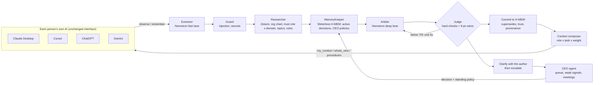

# Steward: one company context, every AI

**Track 03, Reasoning Architecture.** Open Agent Hackathon 2026, team OSEF.

In a small company, everyone already works with their own AI: Claude, ChatGPT, Cursor, Gemini, Mistral. Each of these AIs knows a different, partial, outdated version of the company. **Steward** plugs into each of them through MCP. People keep the AI interface they like, and their AI gains three layers:

- **Watch.** When a conversation touches a company domain (prices, dates, budgets, deals, customers, stack...), the AI sends the relevant excerpt to Steward. Facts are extracted; the raw conversation is never stored.
- **Truth.** Every proposed fact or decision is arbitrated before it becomes shared truth: store, supersede, reject, redact, clarify, escalate or quarantine. Sources are weighted by role × domain: the CEO is a source of truth everywhere, the CTO on tech, an intern barely. A contradiction is first checked with its author ("error or real change?"), then escalated to whoever has authority.
- **Context.** Before answering, the AI receives the smallest useful company context for its owner's role and current task (about 1,500 tokens, every line cited), what changed since their last session, and the formal procedures of their role.

> **We help small companies whose people each use a different AI keep one coherent, role-aware company context. Steward arbitrates what the AIs learn and serves each person the right slice of truth for the task at hand.**

The demo company is **Brikk**: a fictional 12-person startup, plus one intern, selling quote and invoicing software to building craftsmen. All data is synthetic.

## Demo

- Video (1 to 4 min): link added at submission.
- Console walkthrough, recorded from the real app: `python scripts/video/record_console.py` (start `STEWARD_SPACE=video python run.py serve` first).
- Terminal run of the full scenario: `python run.py steward-demo`.

## How it works



| Agent | Owns | Runs on |
| --- | --- | --- |
| Extractor | Candidate decisions, facts and tasks from an excerpt, a document or meeting notes | Nightshift fast lane (Nemotron); deterministic splitter as fallback |
| Intake + guard | Structured facts (topic, amounts, dates), secrets, injection patterns | Code |
| Researcher | Author's role and trust weight, topic owner, limits, Steward rules | Zetaris (SQL over REST, 3 sources) |
| MemoryKeeper | Active decisions on the topic, CEO policies, similar memories | Meterless H-MEM |
| Arbiter (the "prosecutor") | Verdict, confidence, citations | Nightshift deep lane (Nemotron) |
| Judge (Critic) | Hard checks that cannot be argued with, then a 0-9 rubric; sends weak verdicts back, escalates after 2 failures | Code + Nightshift judge lane |
| CEO agent | Escalation queue, standing policies, weak signals, suggested meetings | Code over the journal and the finance source |
| Context composer | The per-role, per-task context served to every AI | Code over H-MEM and Zetaris |

## Quick start

```bash
cp .env.example .env                          # fill in Zetaris and Nightshift values
python3 -m venv .venv && .venv/bin/pip install -r requirements.txt
cd hmem-service && bash setup.sh && npm start &   # Meterless H-MEM engine on :8787
cd .. && .venv/bin/python run.py steward-demo     # the full scenario, one trace per arbitration in logs/
.venv/bin/python run.py serve                     # console: http://localhost:8000/console
```

No Zetaris, Nightshift or keys? `SAMPLE_MODE=true` runs the same agents and the same SQL on SQLite copies of the data. It replays recorded model answers when the exact prompt was seen before (traced as `cached: true`), and otherwise takes the deterministic path. It never returns a stored final answer.

Connect an AI: copy `docs/mcp/claude_desktop_config.json` into Claude Desktop's configuration, or `docs/mcp/cursor-mcp.json` into `.cursor/mcp.json`, and set `OSEF_MEMBER` to the person. `python scripts/mcp_smoke.py` starts the server the way a client does and calls the tools.

Windows: `powershell -ExecutionPolicy Bypass -File scripts\windows\setup.ps1` (see [docs/TEAM-AND-MERGE.md](docs/TEAM-AND-MERGE.md)).

Docker: `docker compose up --build` starts the app (port 8000), the H-MEM engine and the three Brikk sources: Postgres, the finance API served by the app, and an S3-compatible drive. Register them in Zetaris with `python scripts/zetaris/run_steward_sql.py`.

## Commands

| Command | What it does |
| --- | --- |
| `python run.py steward-demo` | The video scenario: onboarding, the same question for two roles, watch layer, clarification, CEO policy, replaced price, protection, weak signals |
| `python run.py serve` | Console at `/console`, its API at `/api/*`, the finance API at `/finance/budgets`, plus `POST /run`, `POST /learn`, `GET /health` |
| `python run.py mcp` | MCP server on stdio: `my_context`, `whats_new`, `observe`, `remember`, `answer_clarification`, `onboard`, `recall`, `why`, `project_brief`, `my_contributions`, `my_tasks`, `report_progress`, `my_alerts`, `escalations`, `resolve_escalation`; resource `osef://watchlist`; prompt `role_procedures` |
| `DOMAIN=project_memory python run.py ablation [--repeats 3]` | Accuracy, memory-dependent accuracy, unsafe errors, consistency, escalation rate per harness profile |
| `python -m pytest -q` | 43 offline tests (23 of them from the Atlas modules) |
| `cd hmem-service && npm run conformance` | Official Meterless H-MEM conformance suite (13 checks) |

## Sponsor technology

| Sponsor | Load-bearing role | Where |
| --- | --- | --- |
| **Zetaris** | One SQL door over three sources: (1) Postgres `brikk`: org chart, trust weights role × domain, topic owners and watchlist, Steward rules, role profiles; (2) the finance REST API: budgets and commitments; (3) the company drive (S3/MinIO): role procedures. A Unified Semantic Layer spans them. Without it, Steward cannot tell who may decide, how much a source weighs, what to watch or what budget is left. | `scripts/zetaris/register_steward.sql`, `domains/project_memory/logic.py`, `context.py` |
| **Meterless H-MEM** | The company memory. Records carry `source`, `confidence` (= the author's trust weight, which multiplies every ranking score), topic, author and AI. Replaced decisions are kept and down-ranked (`supersedes`), and the trust ledger holds the history. CEO policies are corrections that change the next arbitration. | `hmem-service/` (adds `supersedes` and `/list` over the reference), `app/adapters/memory.py`; test: `npm run conformance` |
| **Meterless Nightshift** | Primary AI provider (OpenAI-compatible), three lanes: fast (extraction), deep (arbitration), judge (critique) | `app/llm.py` |
| **NVIDIA Nemotron** | Pinned on the three lanes in Nightshift; the model name is logged on every call | `logs/trace-*.jsonl` (`model` field) |
| **Cursor** | Development environment, and one of the AI clients shown in the demo | `docs/mcp/cursor-mcp.json` |

## Evidence

- Traces: `logs/trace-<run_id>.jsonl`, one line per agent action (agent, action, target, model, confidence, retries, status, `cached`).
- Ablation reports: `logs/ablation-<timestamp>.md`. Offline, on 34 labelled cases: without memory, 56% accuracy and 3 unsafe errors (contradictions let into memory); with H-MEM, 100%, and the CEO is asked 3 times less often. The rules and the cases were written together, so the offline 100% measures consistency. The run that measures the model is the one with Nightshift online. See [docs/STEWARD.md](docs/STEWARD.md).

## Team and merge

Team OSEF: Ryan Dalier-Dulys (Steward: arbitration, context, MCP, console, H-MEM, Zetaris), Adam Semlali and Alexandre Bouchet (Atlas: use case, architecture, decision register, progress per member, alert inboxes, live sponsor checks). The two codebases were merged on 27 October: see [docs/TEAM-AND-MERGE.md](docs/TEAM-AND-MERGE.md).

Team coordination, from the Atlas modules (`app/coordination/`): each person's AI reports progress on their tasks (`report_progress`); Steward flags late work and work that relies on a value a newer decision changed, recommends the meetings that unblock people, and sends each affected person an alert (`my_alerts`) when a decision changes.

## A second domain pack, same harness

The harness is generic: a domain is a folder (`domains/<name>/`) holding rules, data, prompts, cases and a little logic. `domains/admin/` is a personal admin desk that decides what to do with each incoming bill, form or scam (`DOMAIN=admin python run.py demo-memory`). It is kept to show that the architecture does not depend on the use case.

## Limitations

- MCP cannot read a conversation by itself. The watch layer relies on the server instructions and on the client AI following them, so it works best in clients that honour server instructions.
- Identity is declared in each client's configuration (`OSEF_MEMBER`); the AI tool comes from MCP `clientInfo`. Production would use OAuth.
- The H-MEM reference implementation embeds text with a deterministic hash: recall relies on keywords, tags and entities more than on meaning.
- The Zetaris statements follow the official getting-started repository. A JDBC datasource and a local S3 endpoint are not covered by its tested recipes; Postgres copies of every table are the fallback.

## License

Copyright 2026 Ryan Dalier-Dulys. All rights reserved: the code is published for the evaluation of the Open Agent Hackathon 2026 (see `LICENSE`). `hmem-service/vendor/` contains the Meterless H-MEM reference implementation, Apache-2.0 (see `NOTICE`).
