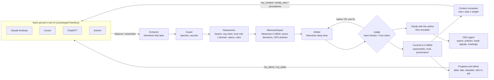

# Steward: one company context, every AI

**Open Agent Hackathon 2026, Track 03 Reasoning Architecture. Team OSEF: Ryan Dalier-Dulys, Adam Semlali, Alexandre Bouchet.**

In a small company, everyone already works with their own AI: Claude, ChatGPT, Cursor, Gemini, Mistral. Each of those AIs knows a different, partial, outdated version of the company. **Steward** plugs into each of them through MCP. People keep the AI interface they like, and their AI gains three layers:

- **Watch.** When a conversation touches a company domain (prices, dates, budgets, deals, customers, stack, ...), the AI sends the relevant excerpt to Steward. Facts are extracted; the raw conversation is never stored.
- **Truth.** Every proposed fact or decision is arbitrated before it becomes shared truth: store, supersede, reject, redact, clarify, escalate or quarantine. Sources are weighted by role x domain: the CEO is a source of truth everywhere, the CTO on tech, an intern barely. A contradiction is first checked with its author ("error or real change?"), then escalated to whoever has authority.
- **Context.** Before answering, the AI receives the smallest useful company context for its owner's role and current task (within a 1,500-token budget, every line cited), what changed since their last session, the formal procedures of their role, and the alerts that concern them.

And the team stays coordinated: each person's AI reports progress on their tasks; Steward marks late work and work built on a value a newer decision changed, alerts the people concerned, and recommends the meetings that unblock them.

> We help small teams whose members each use a different AI decide what becomes the company's shared truth and who needs to know, using a role-and-domain-weighted arbitration over each person's AI conversations, governance data served by Zetaris and a versioned memory in Meterless H-MEM, and produce the right context for each person's role and task, alerts and clarification questions for the people concerned, and an escalation queue with weak signals for the CEO.

The demo company is **Brikk**: a fictional 12-person startup, plus an intern, selling quote and invoicing software to building craftsmen. All data is synthetic. Tagline: *Keep the record straight.*

## Start in three commands (no account, no key)

```bash
python3 -m venv .venv && .venv/bin/pip install -r requirements.txt     # Windows: .venv\Scripts\pip
SAMPLE_MODE=true .venv/bin/python run.py steward-demo                   # the 8-step scenario, one trace per arbitration in logs/
SAMPLE_MODE=true .venv/bin/python run.py serve                          # console: http://127.0.0.1:8000/console
```

`SAMPLE_MODE=true` runs the same agents and the same SQL on SQLite copies of the governance data, a local memory with the same `supersedes` semantics, and the deterministic path instead of the model; a recorded model answer is replayed (traced as `cached: true`) only when the exact prompt was seen on a machine with Nightshift, and this repository ships no such recording, so the committed traces say `model: null`, `cached: false`. The console header, `/health` and every trace say which stack is running (`sample-sqlite`, `local-fallback`, `offline`). Nothing is a stored final answer.

Tests, from the same clone: `.venv/bin/python -m pytest -q` (190 tests, 9 skipped without the team's engine services; `tests/conftest.py` sets `SAMPLE_MODE` so the suite never touches a real stack: 32 on Steward in `test_steward`, `test_harness`, `test_server`, `test_review_round2`, `test_coordination_bridge`, `test_llm_receipt`; 158 on the Atlas modules) and `.venv/bin/python scripts/mcp_smoke.py` (a real MCP client over stdio: the 13 tools of the specification plus 3, the resource and the prompt).

## The real stack

| Layer | Service | How Steward uses it |
| --- | --- | --- |
| DATA | **Zetaris** (local, `localhost:8888/api/v1.0`) | One SQL door over three sources: Postgres `brikk` (org chart, trust weights role x domain, topics with owner and limits, rules, profiles, tasks), the finance REST API (`GET /finance/budgets`, served by Steward), and the company catalogue (role procedures) as a REST table on this repository (jsDelivr, pinned commit). A Unified Semantic Layer `brikk_usl` spans them (`ZETARIS_USE_USL=true`). |
| BUILD | **Meterless H-MEM** (`hmem-service/`, port 8787) | The company memory: provenance, confidence = the author's trust weight, `supersedes` chains (replaced, never deleted), CEO policies. The reference engine is vendored unchanged by `setup.sh` (`vendor/` is not committed); `npm run conformance` passed 13/13 on 27 October, output in `logs/samples/hmem-conformance.txt`. The per-person "seen up to" cursor, the CEO queue and the questionnaire answers are local state files (`data/steward-*`), one set per company space. |
| POWER | **Meterless Nightshift** (`127.0.0.1:8088`) with **NVIDIA Nemotron** | Three lanes pinned by exact id: `nvidia/nemotron-3.5-lightning-30b-a3b` (extractor), `nvidia/nemotron-3-ultra-550b-a55b` (arbiter and judge). The model that answered is read from Nightshift's receipt and written on every trace line. The NVIDIA key lives only in Nightshift. |
| Clients | **Claude Desktop** and **Cursor** | `docs/mcp/claude_desktop_config.json` (the CEO) and `docs/mcp/cursor-mcp.json` (the CTO); identity comes from the client configuration and MCP `clientInfo`, never from the model. |

Setup, once Zetaris and Nightshift run on the machine:

```bash
cp .env.example .env                                   # Zetaris API key and Nightshift runtime token (never committed)
cd hmem-service && bash setup.sh && npm start &        # vendors the Meterless reference, starts H-MEM on :8787
cd .. && docker compose up -d brikk-db                 # source 1 (Postgres with the Brikk tables)
.venv/bin/python run.py serve &                        # source 2 (finance API) and the console
.venv/bin/python scripts/zetaris/run_steward_sql.py    # registers the 3 sources and the USL, one statement per call
.venv/bin/python scripts/configure_nightshift.py       # finds the Nemotron lanes, writes them to .env, makes a test call
.venv/bin/python run.py steward-demo                   # the scenario on the real stack; traces show the model and the sources
DOMAIN=project_memory .venv/bin/python run.py ablation # what memory, rules and the critic each add
```

Mac: `bash scripts/install-zetaris.sh` then `bash scripts/after-zetaris.sh` do all of the above and ask only for the two tokens. Windows: `powershell -ExecutionPolicy Bypass -File scripts\windows\setup.ps1` (details in `docs/TEAM-AND-MERGE.md`). Docker: `docker compose up --build` starts the app, H-MEM and the sources. With a real stack configured, an unreachable H-MEM is an error, never a silent fallback.

## What a judge can run

| Command | What it does |
| --- | --- |
| `python run.py steward-demo` | The scenario of the video: onboarding, the same question for two roles, the watch layer, a clarification, a CEO ruling that becomes a policy, a replaced price and the alert to the people whose work relied on it, the intern's contradiction, a masked secret and a quarantined injection, the CEO's weak signals |
| `python run.py serve` | Console at `/console` (shared truth with topic history, escalations with policies, clarifications, weak signals, context preview, onboarding, simulate an AI with its trace); `POST /run` (one arbitration, the harness contract); `GET /finance/budgets`; `GET /health`. The console has no login: it binds `127.0.0.1` and acts as the CEO of the directory (`STEWARD_CONSOLE_USER` to change) |
| `python run.py mcp` | The MCP server `steward` over stdio: `onboard`, `observe`, `remember`, `my_context`, `whats_new`, `clarifications`, `answer_clarification`, `recall`, `why`, `project_brief`, `my_contributions`, `escalations`, `resolve_escalation` (the specification), plus `my_tasks`, `report_progress`, `my_alerts`; resource `osef://watchlist`; prompt `role_procedures` |
| `python scripts/make_examples.py --check` | Re-runs the three examples of `input_examples/` and compares with `output_examples/` |
| `python -m pytest -q` | 190 offline tests, 9 skipped without the team's engine services (SAMPLE_MODE is set by the suite itself) |
| `cd hmem-service && bash setup.sh && npm run conformance` | The official Meterless H-MEM conformance suite, 13 checks (needs Node and network for the vendoring; the committed run is `logs/samples/hmem-conformance.txt`) |
| `python scripts/mcp_smoke.py` | Starts the MCP server the way Claude Desktop does and calls the tools |

Three examples, generated by running the code (`scripts/make_examples.py`), never by hand:

| Input | Decision | Why |
| --- | --- | --- |
| `example_1_supersede`: the head of Customer Success changes the support hours | **supersede** | His own topic, his authority: the new decision replaces the old record, which stays in the history; cites S07 and the old record |
| `example_2_escalate`: marketing sponsors a show for 15,000 EUR | **escalate** | Above the topic limit and above the CEO's standing policy; nothing is written until the CEO rules; cites S05 |
| `example_3_clarify`: an account executive writes a new price | **clarify** | It contradicts the CEO's price: her AI is asked "error or real change?" before anything moves; cites S06 and the current record |

Traces from real runs are in `logs/samples/` (one JSONL line per agent action, with the model that answered); the ones committed here were produced without Nightshift and say so.

## How it works



| Agent | Owns | Runs on |
| --- | --- | --- |
| Extractor | Candidate decisions, facts, tasks and preferences from an excerpt, a document or meeting notes | Nightshift fast lane (Nemotron); deterministic splitter as fallback |
| Intake and guard | Structured facts (topic, amounts, dates), secrets, injection patterns | Code |
| Researcher | The author's role and trust weight, the topic owner and limits, the Steward rules | Zetaris (SQL over REST, three sources) |
| MemoryKeeper | Active decisions on the topic, CEO policies, similar records | Meterless H-MEM |
| Arbiter (the "prosecutor") | Verdict, confidence, citations | Nightshift deep lane (Nemotron) |
| Judge (the "critic") | Hard checks that cannot be argued with, then a 0-9 rubric; sends weak verdicts back, escalates after two failures | Code + Nightshift judge lane |
| Clarifier | "Error or real change?" to the author of a lower-weight contradiction; a confirmed change goes up, an error is dropped | Code |
| CEO agent | Escalation queue, standing policies raised from a ruling, weak signals (tensions, budgets, late and obsolete work), suggested meetings | Code over the journal, the finance source and the team's progress modules |
| Context composer | The per-role, per-task context served to every AI | Code over H-MEM and Zetaris |

Full description, data model, security and ADRs: [docs/ARCHITECTURE.md](docs/ARCHITECTURE.md). Sponsor usage, file by file: [docs/SPONSORS.md](docs/SPONSORS.md).

## Repository

```
app/            Steward runtime: harness, service, MCP server, console, adapters (Zetaris, H-MEM), coordination bridge
domains/        project_memory (Brikk, the submission) and admin (a second pack on the same harness)
atlas/          the team's Atlas modules: decision register, progress per member, alert inboxes, Zetaris and Nightshift clients
data/           the Atlas corpus and caches (tracked); runtime state (ignored)
hmem-service/   the H-MEM service around the vendored Meterless reference
scripts/        Zetaris registration, Nightshift lanes, Mac and Windows setup, examples, video kit
docs/           ARCHITECTURE, SPONSORS, INVENTORY, PLAN, DECISIONS, TEAM-AND-MERGE, SUBMISSION, PRIOR_WORK, mcp/, atlas/ (the team's documents)
tests/          190 tests; input_examples/ output_examples/ logs/samples/ (traces, the conformance run)
```

Two codebases were merged on 27 October: Steward (Ryan Dalier-Dulys with Claude) and Atlas (Adam Semlali, Alexandre Bouchet). Who built what, and what the merge keeps from each side: [docs/TEAM-AND-MERGE.md](docs/TEAM-AND-MERGE.md) and [docs/INVENTORY.md](docs/INVENTORY.md). The Atlas modules `decisions`, `progress` and `alerts` run inside Steward; `atlas/structured.py`, `state.py`, `hmem.py`, `world_model.py`, `contracts.py`, `sources.py`, and the team's agents of 27 October evening (`extractor.py`, `updater.py`, `controller.py`, `writer.py`, `manager.py`, `orchestrator.py` with its own HTTP entry `python -m atlas.api --port 8080`, versioned prompts in `atlas/prompts/`, and a replay cache of their Nemotron runs in `data/cache/llm/`) are the team's tested pipeline components (schema-validated model calls with the Nemotron receipt, a versioned project state on the World Model engine, an H-MEM client, the Atlas corpus loaders); they are not called by Steward's runtime yet. The team's own services around the Meterless references live in `services/` (`ATLAS_HMEM_URL`, `WORLD_MODEL_URL`), next to Steward's `hmem-service/` (`HMEM_URL`): two wrappers of the same reference engine, to be unified after the event.

## Evidence

- Traces: `logs/trace-<run_id>.jsonl`, one line per agent action (agent, action, target, model, confidence, retries, status, `cached`).
- Evaluation: `logs/ablation-<timestamp>.md`. Offline, on 34 labelled cases: without memory, 56 % accuracy and 3 unsafe errors (contradictions let into memory); with H-MEM, 100 %, and the CEO is asked 3 times less often (9 % of cases instead of 26 %). The rules and the cases were written together, so the offline 100 % measures consistency. The number that measures the model is the Nemotron run: UNKNOWN at the time of writing (not run on a machine with Nightshift yet).
- Conformance: `cd hmem-service && npm run conformance`, 13/13 on 27 October (`logs/samples/hmem-conformance.txt`).

## Known limits

- The watch layer relies on the client AI following the MCP server instructions; MCP cannot read a conversation by itself. The guard in code screens every excerpt before the model sees it, so an injected instruction is quarantined even if the model would have obeyed it; what the client AI does with its own context before calling Steward is outside Steward's reach.
- The console is a trusted local surface: no login, loopback only, the CEO of the directory as operator; "Simulate an AI" takes the author from the form on purpose (a demo device that plays another member's AI, through the same arbitration).
- Identity is declared in each client's configuration (`OSEF_MEMBER`); the AI tool comes from MCP `clientInfo`. Production would use OAuth.
- The finance source is served by the Steward app: when only an MCP server process runs, Zetaris cannot read it, and contexts and signals say so (`warnings`) instead of failing.
- The Zetaris registration for Brikk (`register_steward.sql`: JDBC datasource, REST view, catalogue table, USL) follows the official recipes and the team's live registration of the Atlas corpus, but had not been run against a live Zetaris at the time of writing; Postgres copies of every table are the fallback.
- No trace with a Nemotron model has been produced yet from this code; the team verified the ids and the receipt through Nightshift with `atlas/structured.py`.
- The H-MEM reference embeds text with a deterministic hash: recall relies on keywords, tags and entities more than on meaning.
- The Windows setup script (`scripts/windows/setup.ps1`) is untested.

## License

Code visible for the evaluation of the Open Agent Hackathon 2026, all rights reserved (see `LICENSE`). `hmem-service/vendor/` contains the Meterless H-MEM reference implementation, Apache-2.0 (see `NOTICE`). Prior work: [docs/PRIOR_WORK.md](docs/PRIOR_WORK.md).
