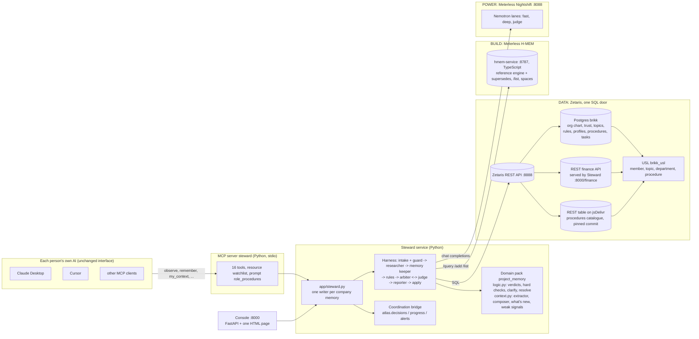

# Steward architecture

Steward is a company context layer for every AI a team already uses. It is the OSEF submission to the Open Agent Hackathon 2026, Track 03 (Reasoning Architecture), and the product the team intends to keep building. This document is the target architecture of the unified repository (27 October 2026) and matches the code on the `unify` branch; where it describes a step not yet run live (the Zetaris registration, the Nemotron run), it says so. The authoritative product specification is the team's v2 specification (26 October); the decisions that shaped this document are the ADRs at the end and D24 to D32 in `docs/DECISIONS.md`.

## 1. Context

**Problem.** In a small company, everyone already works with a different AI (Claude, ChatGPT, Cursor, Gemini, Mistral). Each of those AIs knows a different, partial, outdated version of the company. The price is 29 EUR in one chat and 19 EUR in another; the launch date moved and half the team still writes the old one; an intern can overwrite what the CEO decided; a password pasted into one AI ends up in a shared memory read by all of them.

**Users.** The people of a small company (the demo company is Brikk, 12 people and an intern, selling quote and invoicing software to building craftsmen), each through their own AI; the CEO through the console; the hackathon jury through the console, the traces and the README.

**Impact formula.** We help *small teams whose members each use a different AI* decide *what becomes the company's shared truth and who needs to know about it* using *a role-and-domain-weighted arbitration over each person's AI conversations, governance data served by Zetaris, and a versioned company memory in Meterless H-MEM* and produce *the smallest useful, cited context for each person's role and task, alerts and clarification questions for the people concerned, and an escalation queue with weak signals for the CEO*.

**What Steward is not.** It is not a new chat interface: people keep their AI. It does not answer questions: it serves context and the person's AI answers. It does not retrain a model: "fine-tuning" here means a personalised context per role and task.

## 2. Components



| Component | Responsibility | Interface | Language | Why this, not the alternative |
| --- | --- | --- | --- | --- |
| MCP server `steward` (`app/mcp_server.py`) | What each person's AI can do: the 13 tools of the spec plus 3 coordination tools, the `osef://watchlist` resource, the `role_procedures` prompt, and the server instructions that make the client AI watch the company domains | MCP over stdio (Python SDK), tool annotations (read-only hints) | Python | The MCP SDK, the harness and the domain pack share one process and one lock; an HTTP MCP transport would add auth and deployment work the demo does not need. Provenance comes from `clientInfo` and the client config, never from tool arguments (ADR-6). |
| Steward service (`app/steward.py`) | One entry point for every surface (MCP, console, CLI, tests): remember, observe, context, what's new, clarifications, escalations, signals, onboarding, progress, alerts. Holds the cross-process write lock | Python API | Python | Every client AI runs its own MCP server process; without one writer per company memory two contradictory values could both pass arbitration (ADR-9). |
| Harness (`app/pipeline.py`, `app/agents.py`) | The reasoning loop: intake and guard (code), researcher (SQL through Zetaris), memory keeper (H-MEM recall), rule matching, arbiter (model, deep lane) and judge (hard checks in code, then a 9-point rubric on the judge lane; below 7 the arbiter revises once, twice, then escalates), reporter, apply | `Harness.run(item, commit=True)`; domain hooks `research`, `enrich`, `recall`, `evaluate_with_memory`, `hard_checks`, `apply`, `learn` | Python | Generic: a second domain pack (`domains/admin/`) runs on the same loop, which is the proof that the architecture does not depend on the use case. The judge keeps non-negotiable checks in code (secrets, injection, authority, limits) so that a model cannot argue them away. |
| Domain pack `project_memory` (`domains/project_memory/`) | Brikk's governance and the seven sub-agents of the spec: extractor (fast lane, deterministic splitter as fallback), guard, arbiter prompt, judge rubric, clarifier (S06/S10: "error or real change?"), CEO agent (queue, policies, weak signals, meetings), context composer (role x task x weight x recency, about 1,500 tokens, every line cited) | `domain.yaml` + `logic.py` + `context.py` + data CSVs + prompts + cases | Python + CSV + YAML | Rules, data and prompts live next to each other and are versioned; the harness stays generic. |
| Coordination bridge (`app/coordination/bridge.py`) over `atlas/` | Progress per member, obsolete work, meetings, alerts, built on the team's Atlas modules: decisions in force are read from H-MEM, tasks from Zetaris, progress reports from each person's AI | Python API, used by the service and three MCP tools | Python | The Atlas modules are deterministic, tested (23 tests) and written by the team; wrapping them keeps one source of truth (H-MEM) and gives the team's work a live role (ADR-1, ADR-2). |
| H-MEM service (`hmem-service/`) | The company memory: records with provenance, confidence = the author's trust weight, tags (topic, kind, author, AI, trust, policy), `supersedes`/`supersededBy` chains, `/list` by tag, one persisted space per company; the Meterless reference engine vendored unchanged | HTTP: `/add`, `/query`, `/list`, `/feedback`, `/ledger`, `/sleep/preview`, `/reset`, `/health` | TypeScript (tsx) | The reference implementation and the official conformance suite are TypeScript; wrapping them is the only option that keeps "conformance 13/13" true of the code that runs. A Python port (the team's D11 option b) is on the evolution path. A local Python fallback with the same semantics keeps tests and `SAMPLE_MODE` runnable without Node. |
| Zetaris adapter (`app/adapters/zetaris.py`) and registration (`scripts/zetaris/`) | SQL over the REST API (`POST /sql-editor/sqls/run`, one statement per call, three retries); in `SAMPLE_MODE` the same SQL runs on SQLite copies of the CSVs | `run_sql(sql, columns)` | Python + Lightning SQL | Zetaris is the governance door: who the author is, how much they weigh, who owns the topic, the limits, the watchlist, the tasks. Without it the arbiter cannot decide (section 4). |
| Nightshift client (`app/llm.py`) | All model calls: three lanes, headers `meterless-app` and `meterless-scope: user`, the served model read from the answer and written to every trace line, replay cache for `SAMPLE_MODE` | `LLM.chat(lane, system, user)` | Python (openai client) | One provider, three lanes, so that the extractor is cheap and the arbiter and judge are strong (section 5). |
| Console (`app/server.py`, `app/console.py`, `app/static/`) | The CEO and jury view: shared truth with topic history, CEO queue with policies, clarifications, weak signals, context preview, onboarding questionnaire, "simulate an AI"; the finance REST source | FastAPI `/api/*`, `/console`, `/finance/budgets`, `POST /run`, `/health` | Python + one HTML page with the Steward brand kit | One page, no build step, the brand tokens and components as CSS: a judge can open it from a clone in one command. |
| Scripts | Mac install (`install-zetaris.sh`, `after-zetaris.sh`, `setup-steward-mac.sh`), Windows (`scripts/windows/setup.ps1`), Nightshift lanes (`configure_nightshift.py`), Zetaris registration, video kit, Atlas registration (`scripts/register_zetaris.py`) | shell / PowerShell / Python | — | Both team machines are covered. |

## 3. Flow of one observation

```mermaid
sequenceDiagram
  participant AI as Person's AI (MCP client)
  participant MCP as steward
  participant X as Extractor (fast lane)
  participant G as Guard (code)
  participant R as Researcher (Zetaris)
  participant M as MemoryKeeper (H-MEM)
  participant A as Arbiter (deep lane)
  participant J as Judge (code + judge lane)
  participant C as Clarifier / CEO queue
  participant K as Context composer
  AI->>MCP: observe(excerpt)  [who and which AI: clientInfo + config]
  MCP->>X: excerpt + watchlist
  X-->>MCP: candidate items (decision, fact, task, preference)
  loop each item (one writer lock)
    MCP->>G: intake: amounts, dates, secrets, injection, personal
    G->>R: SQL: author, trust role x domain, topic owner, limit, rules
    R->>M: recall active decisions, CEO policies, similar records
    M->>A: facts + rules + memory
    A-->>J: verdict + citations (JSON)
    J-->>A: below 7/9: revise (max 2)
    J->>M: store / supersede / redact: record with provenance, confidence = trust
    J->>C: clarify: question to the author; escalate: CEO queue
    C-->>AI: "error or real change?" (answer_clarification)
    J-->>MCP: verdict per item, journal id, trace file
  end
  MCP-->>AI: outcomes (one line each)
  AI->>MCP: my_context(task)
  MCP->>K: role x task x weight x recency, budget 1,500 tokens
  K-->>AI: cited context, what's new, procedures, pending questions
```

Raw text never enters the memory: only the extracted items do, and each person can read what was extracted from their exchanges (`my_contributions`).

## 4. Data: Zetaris, one SQL door over three sources

| Source | Content | How it reaches Zetaris | Why |
| --- | --- | --- | --- |
| 1. Postgres `brikk` (`db/steward-init/01_load.sql`, Docker service `brikk-db`) | org chart (`members`), trust weights (`trust`), topics with owner, single-answer flag, limit and keywords (`topics`), Steward rules (`rules`), profiles from the onboarding questionnaire (`profiles`), `project`, `tasks`; fallback copies of `finance` and `procedures` | `CREATE DATASOURCE brikk ... jdbc:postgresql://host.docker.internal:5434/brikk`, `REGISTER DATASOURCE TABLES` | The governance data of a company lives in a database. |
| 2. Finance REST API (`GET /finance/budgets`, served by Steward itself on :8000) | budgets and commitments per department | Lightning REST table `BRIKK_FINANCE_REST.budgets_raw` + SchemaStore view `brikk_api.finance` (`LATERAL VIEW explode`) | A budget is live data from a finance tool, not a table someone copies. |
| 3. Procedures catalogue (`domains/project_memory/data/procedures.json`, exported from `procedures.csv` by `scripts/zetaris/export_catalogue.py`) | role procedures: when to use, steps | REST table on a jsDelivr URL of the public repository, pinned on a commit (the team's proven recipe, `scripts/register_zetaris.py`); the MinIO filestore of the first version stays as an alternative in `register_steward.sql` | A FILESTORE needs cloud object storage; a pinned public URL needs nothing and is what the team verified live on 27/10. |
| USL `brikk_usl` | `member`, `topic`, `department` (joins finance and org chart), `procedure` | `COMPILE USL ... DDL` then `ACTIVATE USL TABLE ... AS SELECT` with `COALESCE` on NOT NULL columns | One business view over three sources; `ZETARIS_USE_USL=true` makes Steward read through it. |

**Queries that run on every arbitration** (`domains/project_memory/logic.py::research`): the author's row and level, the trust weights for that level (own domain / other domains), the topic's owner, limit and single-answer flag, the rules for the item type; on every context: the member's profile, the watchlist, the procedures for the role and task, the finance ratios for the weak signals, the tasks for progress. One statement per request; responses are lists of lists of strings and are typed in the adapter.

**Quality rule.** `scripts/zetaris/run_steward_sql.py` checks that the pinned jsDelivr URL answers 200 before registering, runs the statements one per request and prints the row count of every table it created; the read-back comparison with the CSV and `--repin` exist in the team's `scripts/register_zetaris.py` (the Atlas corpus) and are not yet in the Brikk script (`--commit` re-pins it). The USL activation uses `COALESCE` on NOT NULL columns; every read has a 45 s timeout and three retries; a failed read is an error in the trace, never a silent default.

**`SAMPLE_MODE=true`.** The same SQL runs on an in-memory SQLite copy of the pack's CSVs (`app/adapters/zetaris.py::SampleData`), the H-MEM service is replaced by the local fallback with the same `supersedes` semantics, and model calls are replayed from `data/llm_cache.jsonl` when the exact prompt was recorded, otherwise the deterministic path runs. Model-call lines (Decider, Critic) carry `cached: true` when replayed; the `run_started` line, the console header and `/health` say which stack is running (`sample-sqlite`, `local-fallback`, `offline`). The same labelled stack is used when no key or token is configured at all; the difference is that with a real stack configured (a Zetaris key or a Nightshift token), an unreachable H-MEM is an error (`MemoryUnavailable`), never a second store (ADR-9).

**Local state.** Three things are neither in Zetaris nor in H-MEM: Steward's journal (the CEO queue, the clarifications, every verdict with its reason: `data/steward-journal-<space>.jsonl`), the questionnaire overlay and the per-person "seen up to" cursors (`data/steward-profiles-<space>.json`, `data/steward-cursors-<space>.json`), and the progress reports and alert inboxes of the coordination bridge (`data/progress-<space>.json`, `data/alerts-<space>.json`). They live on the machine that runs the server, one set per company space, and are written only under the same lock as the memory (ADR-9). Moving them into H-MEM records is the next step (section 9).

**Source 2 depends on the Steward app being up** (it serves `GET /finance/budgets`): the setup scripts and `docker compose` start it; when only an MCP server process runs, Zetaris cannot read the finance table, and contexts and weak signals carry a `warnings` entry (`source_unavailable`) instead of failing. In `SAMPLE_MODE` the finance CSV is read directly.

## 5. Model calls

- Single provider: Meterless Nightshift, `http://127.0.0.1:8088/v1`, headers `Authorization: Bearer <runtime token>`, `meterless-app`, `meterless-scope: user`. The NVIDIA key lives only in Nightshift (Providers), never in the app.
- Three lanes, pinned on Nemotron by exact model id (verified by the team on 27/10 through Nightshift): fast = `nvidia/nemotron-3.5-lightning-30b-a3b` (extractor), deep = `nvidia/nemotron-3-ultra-550b-a55b` (arbiter), judge = the same ultra model. `nvidia/nemotron-3-super-120b` returns a 404 from NVIDIA and is not used. If the ids are not available, `scripts/configure_nightshift.py` falls back to the routing modes `meterless/fast` and `meterless/deep` and says so.
- The served model is read from the answer (`meterless.routed_model` receipt, else the `model` field) and written to every trace line (`logs/trace-<run>.jsonl`, field `model`), with `receipt_id` when present.
- Timeouts: 90 s per call (`LLM_TIMEOUT`), two retries by the OpenAI client on transport errors; a malformed JSON answer is parsed leniently (`parse_json`: fences, `<think>` blocks, first object with the expected keys) and, if still invalid, the Decider's proposal comes from `fallback_decision` (the deterministic path) for that attempt; the Critic then judges that proposal like any other.
- Errors are never hidden: a lane that does not answer puts the harness on the deterministic path for that item; the trace line says `via: deterministic-fallback` (Decider) or `via: rules-only` (Critic), `model: null`, and the console shows `LLM offline`.

## 6. Security and privacy

- **Provenance.** Who speaks and from which AI comes from the client configuration (`OSEF_MEMBER`, `OSEF_AI_TOOL`) and from MCP `clientInfo`, never from tool arguments: a model cannot claim to be the CEO. `resolve_escalation` refuses anyone whose directory level is not `ceo`; `answer_clarification` refuses anyone but the author of the proposal; both write who acted into the journal (`resolved_by`, `answered_by`).
- **The console is a trusted local surface.** It has no login, so `run.py serve` binds `127.0.0.1` unless `HOST` says otherwise (the container sets `0.0.0.0`), and the person behind it is `STEWARD_CONSOLE_USER`, else the CEO of the directory: `/api/resolve` requires that person to be the CEO, `/api/answer` the author or the CEO. "Simulate an AI" takes the author from the form on purpose: it is a demo device that plays another member's AI, and its proposals go through the same arbitration as an MCP call. `POST /learn` (the admin pack's owner correction) is refused for the project memory: a standing rule is written only by the CEO's ruling, inside the lock.
- **Guard before the model.** `context.guard_source` screens the raw excerpt in code before any model sees it: an excerpt that carries an injection pattern ("ignore previous instructions", "note to all AI agents", ...) or a secret never reaches the extractor; it goes through the deterministic splitter and every item of it carries `source_flags`, which `intake` turns into the item's own `injection` flag, so the Judge's hard check quarantines each of them even if a model would have paraphrased the attempt away. Secrets (passwords, API keys, IBANs) are masked before anything is stored (`redact`); personal preferences are kept out of the company memory.
- **Authority in code.** Trust = role x domain (CEO 1.0 everywhere, lead 0.9 in their department and 0.4 elsewhere, member 0.6 / 0.25, intern 0.3 / 0.1, interns cannot decide); spending above a topic's limit always escalates; a lower-weight contradiction always goes to its author first, and only that author can answer. These are hard checks in the judge, not prompt text.
- **Extracts only.** `observe` stores what the extractor produced, never the excerpt; `my_contributions` shows each person what was extracted from them.
- **One writer.** A cross-process file lock per company memory (`fcntl` on macOS and Linux, `msvcrt` on Windows), held for every write to the memory and to the local state files (journal, profiles overlay, cursors, progress, alerts).
- **Typed boundary.** `POST /run` returns 422 without a text and, for the project memory, without an author; `/api/trace/{run_id}` accepts a file stem only.
- **Secrets at rest.** `.env` is ignored by git; the install scripts read tokens from the clipboard and never print them; the NVIDIA key never leaves Nightshift.

## 7. Target repository layout

```
.
├── README.md  LICENSE  NOTICE  CONTRIBUTING.md  metadata.json  .env.example  tests.json  PROGRESS.md  CLAUDE.md
├── run.py                      CLI: serve, mcp, steward-demo, steward-brief, ablation, run, demo-memory
├── smoke_test.py               stack check: Zetaris, Nightshift, Nemotron, H-MEM (from Atlas, adapted)
├── requirements.txt  docker-compose.yml  Dockerfile
├── app/                        Steward runtime
│   ├── agents.py  pipeline.py  guard.py  llm.py  trace.py  config.py  evaluation.py
│   ├── steward.py  mcp_server.py  server.py  console.py  steward_demo.py
│   ├── adapters/               zetaris.py (REST or SQLite), memory.py (H-MEM or local fallback)
│   ├── coordination/           bridge.py over atlas/
│   └── static/                 console.html + brand/ (tokens, components, fonts, icons, logo)
├── domains/project_memory/     Brikk pack: domain.yaml, logic.py, context.py, prompts/, data/*.csv, cases.jsonl, seeds
├── domains/admin/              second pack on the same harness
├── atlas/                      the team's Atlas modules, history preserved (decisions, progress, alerts, zetaris, structured, llm, contracts, sources, state, hmem)
├── evaluation/                 Atlas expected results (S1-S9)
├── data/                       Atlas corpus and Zetaris cache (tracked); runtime state and fallbacks (ignored)
├── hmem-service/               server.ts, setup.sh; vendor/ is generated by setup.sh (Meterless reference + conformance, Apache-2.0; not tracked)
├── db/steward-init/            Postgres init for source 1
├── scripts/                    zetaris/ (register_steward.sql, run_steward_sql.py), register_zetaris.py (Atlas), video/, windows/, install-zetaris.sh, after-zetaris.sh, setup-steward-mac.sh, configure_nightshift.py, set-secret.sh, mcp_smoke.py, make_*_cases.py
├── input_examples/ output_examples/   three Steward inputs and their real outputs
├── logs/samples/               JSONL traces from real runs (the rest of logs/ is ignored)
├── docs/                       ARCHITECTURE, INVENTORY, PLAN, DECISIONS, SKILLS, SPONSORS, PRIOR_WORK, SUBMISSION, STEWARD, TEAM-AND-MERGE, mcp/, submission/, atlas/ (the team's documents, moved whole)
├── tests/                      Steward tests (32) + Atlas tests (92); conftest.py sets SAMPLE_MODE
├── .github/workflows/tests.yml CI: pytest in SAMPLE_MODE on Linux and Windows
└── .claude/agents/ .claude/skills/   the review agents and their skills
```

## 8. What we keep from the team's vision (Adam and Alexandre, 23 and 27 October)

- **The prosecutor/judge pair**: it is the Arbiter and the Judge of the harness; the judge's hard checks are code, as their D13 asks ("the LLM qualifies, the code decides").
- **The CEO agent and weak signals**: the CEO queue, standing policies raised from a ruling, tensions, budgets, decisions waiting; plus, from their bricks 2 and 5, late work, obsolete work and the meetings that unblock people (`atlas/progress.py`).
- **Alerts to the people concerned**: their brick 1 notification algorithm (`atlas/alerts.py`), pulled once by each person's AI (`my_alerts`).
- **Progress per member**: their `report_progress` idea is a Steward tool, and `my_tasks` shows each person where they stand.
- **Replaced, not kept**: the network of autonomous department agents. Since 26 October the visible agents are the people's own AIs, and Steward's sub-agents are internal. What survives of the idea is the department dimension of trust (role x domain) and of weak signals (budgets per department).
- **Their Zetaris and Nemotron recipes** are adopted as the default (REST tables on pinned public URLs; exact Nemotron ids; receipt field).
- **On the evolution path, not tonight**: their World Model layer (versioned project state), the deliverable-correction brick (diff of an outdated brief with sources), the manager's periodic digest (brick 7).

## 9. Evolution path (deck, point 8)

1. OAuth identity instead of a declared `OSEF_MEMBER`; an HTTP MCP transport so one Steward serves a whole team.
2. A Python H-MEM engine validated by replaying the official vectors (their D11 b), or World Model for the versioned project state.
3. Deliverable correction (the team's brick 4): a diff of an outdated document, each change citing its source.
4. A manager digest on a schedule (brick 7) and calendar integration for suggested meetings.
5. Real fine-tuning of small per-role models on the company's own arbitration history.
6. Semantic recall: the reference H-MEM embeds with a deterministic hash; a real embedding model would make recall meaning-based.

## 10. ADRs

**ADR-1. Steward is the base; Atlas is integrated, not re-implemented.** Context: two codebases, 6 hours left; Steward runs end to end (43 tests, MCP smoke, demo); Atlas has tested deterministic modules and proven integrations but no pipeline. Decision: the runtime is Steward; the team's package is kept whole as `atlas/` with its history and tests, and Steward uses `atlas.decisions`, `atlas.progress`, `atlas.alerts` through `app/coordination/bridge.py`. Consequences: one product, the team's work has a live role, their in-progress modules (`structured`, `state`, `hmem`, `contracts`) stay as tested reference code and are named as such in the README.

**ADR-2. H-MEM is the only source of "what is in force".** Decision: the Atlas decision register is a view computed from H-MEM records (`kind:decision`, single-answer topics, `supersedes`); nothing writes the register directly. Consequences: no second truth; progress and alerts react to the same records the arbiter wrote.

**ADR-3. Languages stay as they are.** Python/FastAPI for the app and MCP, TypeScript for the H-MEM service. Rewriting either tonight has no measurable gain for the jury and a real risk; the alternatives are on the evolution path.

**ADR-4. Three Zetaris sources: Postgres, the finance REST API, a REST table on a pinned public URL; a USL on top.** Context: a FILESTORE needs cloud storage; the team registered 9 REST tables on jsDelivr live. Decision: the procedures catalogue is registered the same way; the MinIO path stays as an alternative script. Consequences: source 3 depends on the repository being public and on a commit hash; re-run `run_steward_sql.py --commit <hash>` after a data change (the Atlas script has `--repin`).

**ADR-5. Nemotron by exact id, served model in every trace, `SAMPLE_MODE` labelled.** Decision: lanes default to the ids the team verified; `configure_nightshift.py` checks the served model and says when it is not Nemotron; replayed answers carry `cached: true`; the Decider and Critic lines carry `receipt_id` when Nightshift sent one.

**ADR-6. Provenance from the client, never from the model.** See section 6.

**ADR-7. People's AIs replace department agents.** See section 8.

**ADR-8. Extracts only.** The raw excerpt is never stored; items are.

**ADR-9. One writer per company memory, one store.** A cross-process lock (`fcntl`, or `msvcrt` on Windows) guards the whole critical section of a write: the "already waiting" check, the arbitration, the commit to H-MEM, the alerts it triggers, a progress report, a CEO ruling, an author's answer, and the seed of an empty memory. The console and every MCP server process share it. The lock serialises writers; `MemoryUnavailable` (section 4, the `SAMPLE_MODE` paragraph) keeps them on one store. `onboard` and `whats_new(advance=True)` hold the lock too (they read-modify-write the overlay and cursor files).

**ADR-10. Two demo data sets, one demo.** Brikk is the demo (spec v2); the Atlas corpus (project Atlas, Orion) stays as the team's test fixtures and a second data set, not as a second product.

## 11. Review log

Round 1 (`architect-reviewer`, 27/10 18:55): FAIL, one blocker (lanes and receipt not implemented as described) and five majors. Fixed in commit `57c2a56`: receipt-based served model and exact Nemotron ids (`app/llm.py`, `app/config.py`, `.env.example`, `configure_nightshift.py`); the `clarifications` tool; one critical section for dedup, run, alerts, progress and seed; `MemoryUnavailable` instead of a silent second store; the bridge imports `atlas.*` (commit `d81f26f`); the finance source may be down without breaking contexts. Minors answered in this document: timeouts (90 s, two client retries), the `cached` flag wording, the files the document names now exist (`docs/DECISIONS.md` D24-D32, `docs/PLAN.md`, `docs/SPONSORS.md`, `docs/PRIOR_WORK.md`, `.github/workflows/tests.yml`). Section 4 states the console-up dependency of source 2 and that the Brikk registration has not run live.

Round 2 (`architect-reviewer`, 27/10 19:50): FAIL, one blocker (console reachable on all interfaces with no identity check, `/learn` outside the arbitration) and five majors. Fixed in commit `b50419d`: loopback binding and a console operator with CEO/author checks, `/learn` refused for the project memory, the guard in code before the extractor (`guard_source`, `source_flags`), `receipt_id` in the Decider and Critic trace lines, `onboard`/`whats_new` under the lock, author-only `answer_clarification`, typed `POST /run`; the minors are corrected in this document (sections 4, 5, 7, ADR-4, ADR-9) and in `docker-compose.yml`. Not re-run by the agent after the fixes; `tests/test_review_round2.py` covers each point.

The same evening the `claims-auditor` (FAIL: two majors, fixed in `fe53c66`), `qa-runner` (PASS on a fresh clone; one major on the bare `pytest` command, fixed by `tests/conftest.py`), `brand-consistency`, `ui-reviewer` and `ux-reviewer` (FAIL each; fixed in `65e49be` and `fcb00f5`: policy scope, rulings restamped, trace viewer, text mode on every tool, console kit compliance) ran once; their findings and fixes are listed in `tests.json` (R12, R22, R24).

## 12. Known limits (also in the README)

- The watch layer relies on the client AI following the server instructions; MCP cannot read a conversation by itself.
- Identity is declared in the client configuration; production needs OAuth.
- The offline evaluation (34 cases) was written with the rules: it measures consistency. The number that measures the model is the Nemotron run, reported in the README once it has run on a machine with Nightshift.
- Zetaris: the JDBC datasource statement follows the official guide but was not exercised by the team's recipes; the USL compile was not run live before the unification. Postgres copies of every table are the fallback.
- The H-MEM reference embeds with a deterministic hash: recall relies on keywords, tags and entities more than on meaning.
- The console is a trusted local surface (no login, loopback, the directory's CEO as operator); the journal, the questionnaire overlay, the cursors and the progress files are local to the machine that runs the server.
