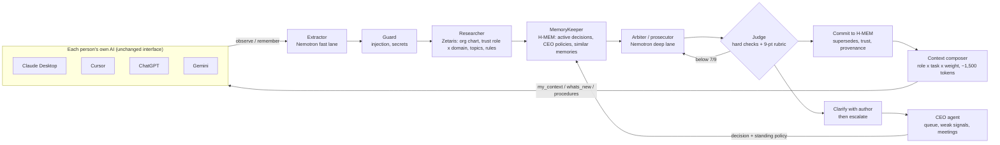

# OSEF Steward: the company context layer for every AI

**The pitch.** In a small company, everyone already works with their own AI: Claude, ChatGPT, Cursor, Gemini, Mistral. Each of these AIs knows a different, partial, often outdated version of the company. The OSEF Steward plugs into each of them through MCP. The user keeps the AI interface they like. Their AI gains three layers:

| Layer | What it does |
| --- | --- |
| **Watch** | When the conversation touches a company domain (prices, dates, budgets, deals, customers, stack...), the AI sends the relevant excerpt to the Steward. Only extracted facts are kept, never the raw conversation. |
| **Truth** | Every proposed fact or decision is arbitrated before it becomes shared truth. Sources are weighted by role × domain: the CEO is a source of truth everywhere, the CTO on tech, an intern barely. Contradictions are clarified with their author ("error or real change?"), then escalated to whoever has authority. |
| **Context** | Before answering, the AI receives the smallest useful context for this person's role and this task (about 1,500 tokens). The CTO gets the technical side, the CEO the managerial side. It also gets what changed since the last session, and the formal procedures of the role. |

This is the "fine tuning" of the product vision, done without retraining any model. It works on two planes:
- **personal**: role, focus, detail level, followed topics;
- **global**: weighted sources of truth, company decisions, CEO policies.

**Impact sentence.** We help small companies whose people each use a different AI keep one coherent, role-aware company context. The Steward arbitrates everything the AIs learn and serves each person the right slice of truth for the task at hand. The output is decisions, facts and context that are sourced, versioned and justified.

The demo company is **Brikk**: a fictional 12-person startup, plus one intern, making quote and invoicing software for building craftsmen. All data is synthetic.

## Architecture



| Sponsor | What it carries (what breaks without it) |
| --- | --- |
| **Zetaris**, 3 sources behind one SQL door | (1) Postgres `brikk`: org chart, trust weights role × domain, topic ownership and watchlist keywords, Steward rules, role profiles. (2) The finance REST API (`GET /finance/budgets`): budgets and commitments. (3) The company drive (S3-compatible MinIO): formal role procedures. Without Zetaris the Steward does not know who may decide, how much each person weighs, what to watch, or how much budget is left. |
| **Meterless H-MEM** | The company memory itself. Each record has `source`, `confidence` (set to the author's trust weight, which multiplies every ranking score), topic, kind, author and AI. Replaced decisions are kept and down-ranked (`supersedes` / `supersededBy`), and the trust ledger holds the history. CEO policies are corrections that change the next arbitration. |
| **Meterless Nightshift + NVIDIA Nemotron** | The extractor (fast lane), the arbiter (deep lane) and the judge (judge lane). The model is logged on every call. |
| **MCP** | The watch, truth and context layers inside any AI. The AI tool is read from the MCP `clientInfo`; the member comes from the client's configuration. |

How the team's ideas map onto the build:

| Idea | Where it lives |
| --- | --- |
| "Octogone" of department agents | Each person's own AI |
| Couriers | `whats_new` and `my_context` |
| Prosecutor and judge | Arbiter and Critic |
| CEO agent | Escalation queue, standing policies, weak signals and suggested meetings |
| Memory from meetings | `observe(source="meeting")` |

## The seven verdicts (`domains/project_memory/data/rules.csv`)

| Rule | When | Verdict |
| --- | --- | --- |
| S01 | The text tries to instruct the AIs that read the memory | quarantine |
| S02 | Secret or personal data | redact (mask, then store) |
| S03 | Personal working preference | reject (it stays in the person's own AI) |
| S04 | Duplicate of an active memory, with no new figure | reject |
| S05 | Commits money above the owning department's limit | escalate |
| S06 | Changes a single-answer topic without authority, or from a lower weight than the decision's author | **clarify** |
| S07 | Changes it with authority (lead of the owning department or CEO) and at least the same weight | supersede |
| S08 / S09 | New decision on a topic the author's department owns / does not own (or by an intern) | store / escalate |
| S10 / S11 | A fact that contradicts the active decision / a fact with no conflict | **clarify** / store |
| S12 | Task with an owner | store |

**Trust weights** (Zetaris table `trust`), given as own department / other departments:

| Role | Own department | Other departments |
| --- | --- | --- |
| CEO | 1.0 | 1.0 |
| Lead | 0.9 | 0.4 |
| Member | 0.6 | 0.25 |
| Intern | 0.3 | 0.1 |

A CEO policy that covers the department, the topic and the amount overrides S05/S09. The judge's hard checks cannot be argued with:
- an injection that is not quarantined;
- a secret stored in clear;
- a `supersede` that does not cite the decision it replaces;
- a `supersede` from a lower-weight source;
- a second decision on a single-answer topic (a silent contradiction);
- a change outside the author's authority with no CEO policy cited.

## MCP surface

| Tool | Kind | Purpose |
| --- | --- | --- |
| `my_context(task)` | read | Role-tailored company context for this task, about 1,500 tokens, with cited ids |
| `whats_new()` | read | Changes since the person's last session, questions waiting for them, signals that concern them |
| `observe(excerpt, source)` | write | The watch layer: an excerpt of a conversation, a document or meeting notes. Items are extracted and arbitrated; the raw text is never stored. |
| `remember(content, kind, topic)` | write | One explicit item |
| `answer_clarification(id, error\|change)` | write | Answers "error or real change?" |
| `onboard(...)` | write | The role questionnaire (shapes the context, never grants authority) |
| `recall`, `why(topic)`, `project_brief`, `my_contributions` | read | Search, topic history, shared truth, what was extracted from my conversations |
| `escalations`, `resolve_escalation` | read / write (CEO) | The CEO queue and weak signals; answer and set a standing policy |

The server also exposes a `osef://watchlist` resource (the watched domains, from Zetaris) and a `role_procedures` prompt. Its instructions tell the AI when to call `my_context`, `whats_new` and `observe`.

## Results (offline, deterministic fallback, 34 labelled cases)

`DOMAIN=project_memory SAMPLE_MODE=true python run.py ablation` gives the same results with the real H-MEM engine and with the local fallback:

| Profile | Accuracy | Memory-dependent cases (15) | Unsafe errors | CEO escalation rate |
| --- | --- | --- | --- | --- |
| rules_only / no_memory | 56% | 0% | 3 | 26% |
| full | 100% | 100% | 0 | 9% |

Without memory, the Steward lets contradictions and duplicates into the company memory: those are the 3 unsafe errors. With memory and clarification, the CEO is asked 3 times less often (9% of cases instead of 26%), because contradictions are first checked with their author.

**Honest caveat.** The deterministic rules and the cases were written together, so 100% offline measures consistency, not intelligence. The meaningful run is with Nightshift online: Decider and Critic on Nemotron. That run measures what the model adds, breaks, and how stable it is.

## Run it

```bash
python run.py steward-demo        # the video scenario; each arbitration is a real run with its own trace in logs/
python run.py serve               # console at http://localhost:8000/console, finance API at /finance/budgets
python run.py mcp                 # MCP server on stdio (see docs/mcp/ for Claude Desktop and Cursor)
python scripts/mcp_smoke.py       # starts the MCP server like a client would and calls the tools: PASS
DOMAIN=project_memory python run.py ablation
python -m pytest -q
```

## Limits (said plainly)

- MCP cannot read a conversation by itself. The watch layer relies on the server instructions and on the AI following them, so it works best in clients that honour server instructions (Claude Desktop, Cursor).
- Identity is declared in the client configuration (`OSEF_MEMBER`); production would use the MCP client's OAuth.
- Weak signals are rules over the journal and the finance source. Meeting transcripts go through the same extractor; no audio pipeline is included.
