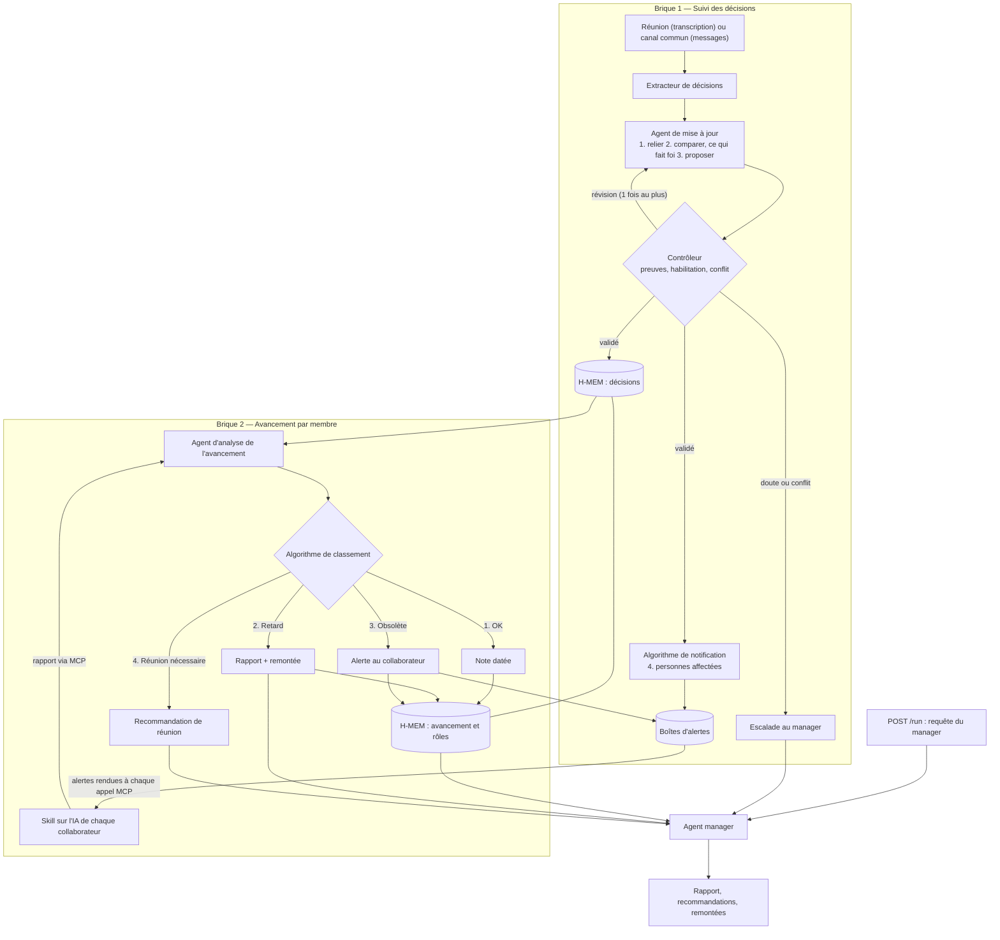

# Architecture — brouillon

**État : brouillon de travail, très loin de l'architecture finale.** Rédigé par l'équipe le 27 octobre 2026, puis complété avec les propositions A à G de la revue (voir la fin du document). Beaucoup de fonctionnalités et de mécanismes restent à concevoir. Notes manuscrites d'origine : [architecture-notes/](architecture-notes/) (page 1 : suivi des décisions ; page 2 : avancement par membre).

Principes suivis : [reference/guide-architecture-agentique.md](reference/guide-architecture-agentique.md). Cas d'usage : [use-case-atlas.md](use-case-atlas.md). Critères du jury : [strategie/prompt-jury.md](strategie/prompt-jury.md).

**Track retenu : 03 — Reasoning Architecture** (proposition G) : l'utilisateur principal est le manager, et le système transforme données et mémoire en décisions et en actions (alertes, corrections, réunions).

---

## 1. Objectif, décision, action
Quelle décision le système aide-t-il à prendre, et quelle action en découle ?
Le système aide à gérer la cohérence dans le travail entre différentes personnes utilisant plusieurs modèle d'IA différentes sur leur PC dans un projet d'entreprises. Il alerte si jamais une personne fait un travail qui a été rendu obsolète par une décision qui a été prise par un autre colaborateur ou une contrainte technique qui est survenu. Il gère aussi généralement l'ensemble des informations relative a un projet ( quelle est la répartition des tâches, quel est le projet en question, quelles sont les deadlines, quelles sont les postes de chacun, quelle est l'avancement de chaque tâches ) et peut en ressortir des informations pertinentes pour la personne en charge du projet ou le manager de l'équipe ( ce système s'adapte donc aussi bien à la gestion d'une équipe par un manager qu'a la réalisation d'un projet cadré, avec chef de projet etc... ). Les informations pertinentes qu'il ressort concerne aussi bien un transfert d'information horizontal ( d'un collaborateur à un autre collaborateur par exemple ), que vertical ( le harness constate une irrégularité ou un problème quelque part dans le projet, remonte l'information jusqu'au manager pour le prévenir ). C'est également lui qui, par le suivis qu'il fait de l'avancé du projet ou du travail de chacun, planifie les réunions lorsqu'il est pertinent et utile d'en faire une pour l'avancer du projet ( l'idée est de limiter le nombre de réunion et de n'avoir que des réunions qui soient utile ). Le système stock également à différentes échelles de mémoire les avancées du projet et garde toutes les données de base qu'il peut récolter ( compte rendu de réunion par exemple, historique des informations d'un projet une fois le projet terminé etc... avec donc des mémoires à plusieurs échelles : mémoire sur le projet en cours, la journée de travail etc... et mémoire de l'ensemble des projets qui ont été fait )
- Utilisateur principal : le manager 
- Entrée (exemple de requête) : Fais moi un compte rendu de l'avancé du projet "X", de ce que chacun a fait, et de savoir si oui ou non nous allons suivre les deadlines que nous avons fixé. Si ce n'est pas le cas explique moi pourquoi. 
- Sortie (format, contenu) : Rapport détaillé qui répond à la question qui a été formulé par le manager. Peut aussi bien prendre la forme d'un rapport écrit que d'un rapport avec une analyse de donnée ou autre ainsi que des recommandations sur ce qui doit être fait si besoin. 

**Point d'entrée** (proposition F) : cette requête du manager est l'entrée principale du système, exposée par `POST /run` (entrée et sortie structurées). C'est ce que les juges appelleront.

## 2. Composants
Pour chaque composant : agent LLM ou code déterministe ? Le jury pénalise « un agent avec plusieurs étiquettes ».

L'architecture est découpée en **briques**, une par capacité. Deux briques sont définies à ce stade, plus l'agent manager.

### Brique 1 — Suivi des décisions
Bilan de la brique : 1 capacité, 1 mémoire H-MEM, 3 agents, 1 algorithme.

| Composant | Type (LLM / code) | Rôle | Entrées | Sorties | Modèle |
|---|---|---|---|---|---|
| Extracteur de décisions | LLM | Extrait les décisions d'un texte, selon le type de source : pour une réunion, il rédige aussi le compte rendu ; pour le canal commun (Slack ou autre), il ne garde que les décisions (deadlines, etc.), en tenant compte du contexte déjà connu. Fusion des deux agents du brouillon manuscrit (proposition A) | Transcription de réunion ou messages du canal, type de source, décisions déjà en mémoire | Compte rendu (réunion), décisions candidates au format ci-dessous | Nemotron via Nightshift (à préciser) |
| Agent de mise à jour des décisions | LLM | ① relie entre elles les décisions déjà prises (dates, deadlines…) ; ② compare avec ce qui a été décidé et **propose ce qui fait foi et ce qui ne fait pas foi**, au regard des données récoltées ; ③ propose la modification de la mémoire | Décisions candidates, mémoire des décisions | Proposition de mise à jour, avec ses preuves | Nemotron via Nightshift (à préciser) |
| Contrôleur (proposition B) | Règles déterministes + LLM | Vérifie la proposition avant toute écriture : preuves citées, habilitation de l'auteur de chaque décision (table des rôles, jamais le texte d'un message), conflit avec une décision en vigueur (contrôle fait à chaque mise à jour, car H-MEM ne détecte ses conflits qu'une fois par jour). Accepte, demande **une révision au plus** à l'agent de mise à jour, ou **escalade vers le manager** | Proposition de mise à jour, mémoire des décisions, rôles | Mise à jour validée écrite dans H-MEM, demande de révision, ou escalade | Nemotron via Nightshift (à préciser) |
| Algorithme de notification | Code déterministe | ④ détermine les personnes affectées par la modification et dépose une alerte dans leur **boîte d'alertes** (proposition D) | Mise à jour validée, rôles et tâches de chacun | Alertes par collaborateur | — |
| Mémoire des décisions | H-MEM | Les décisions et leur historique | — | — | — |

**Classification des décisions** (utile aussi à la brique 2) :
- deadline sur un livrable ;
- tâche donnée à X personnes, avec deadline.

### Brique 2 — Avancement par membre
Elle s'appuie sur la brique 1 (les décisions classées) et sur une mémoire du rôle de chacun dans le projet.

| Composant | Type (LLM / code) | Rôle | Entrées | Sorties | Modèle |
|---|---|---|---|---|---|
| Skill de rapport d'avancement | Skill installé sur l'IA de chaque collaborateur, sur son PC | Fait remonter l'avancement du travail du collaborateur via MCP ; à chaque rapport, récupère aussi les alertes qui l'attendent (proposition D) | Travail du collaborateur | Rapport d'avancement ; affichage des alertes | IA du collaborateur |
| Agent d'analyse de l'avancement | LLM, **sans outil d'écriture** sur les sources qu'il consulte | Lit les rapports envoyés depuis les PC des collaborateurs et les compare aux tâches assignées et aux objectifs | Rapports, tâches, objectifs, décisions (brique 1) | Statut par collaborateur | Nemotron via Nightshift (à préciser) |
| Algorithme de classement (dans l'agent d'analyse) | Code déterministe | Classe chaque situation en quatre cas (voir ci-dessous) | Statuts des collaborateurs | Note, rapport, alerte ou recommandation de réunion | — |
| Mémoire de l'avancement et des rôles | H-MEM, connectée à la mémoire de la brique 1 | Rôle de chacun dans le projet ; avancement au niveau individuel | — | — | — |

**Les quatre cas de l'algorithme de classement :**
1. **Pas de problème** : une note datée (date, heure) indique que tout est en ordre pour cette personne, qui suit sa deadline.
2. **Retard** : même chose, plus un rapport, et l'information remonte.
3. **Travail obsolète** par rapport à une décision prise : une alerte est déposée dans la boîte du collaborateur pour le lui signaler.
4. **Réunion nécessaire** (proposition C) : une même décision rend obsolète le travail de deux personnes ou plus, ou une tâche en retard bloque celle d'un autre membre. L'agent manager rédige la recommandation (participants, raison, preuves, ordre du jour), soumise au manager.

Dans tous les cas, l'information sur l'avancement du projet au niveau individuel est enregistrée dans la mémoire, reliée à celle de la brique 1.

### Agent manager (proposition F)
| Composant | Type (LLM / code) | Rôle | Entrées | Sorties | Modèle |
|---|---|---|---|---|---|
| Agent manager | LLM | Répond à la requête du manager (section 1) : avancement du projet, travail de chacun, tenue des deadlines et pourquoi ; rédige les recommandations de réunion ; produit les remontées automatiques | Mémoires des briques 1 et 2, alertes, escalades du contrôleur | Rapport au manager, recommandations, remontées | Nemotron via Nightshift (à préciser) |

## 3. Flux de contrôle
Qui décide de l'étape suivante : le code (workflow) ou le modèle (agent) ? Où sont les boucles (critique, révision, retry), les branchements (confiance, conflit) et les escalades vers un humain ? Quelles limites (nombre d'itérations, budget, timeout) ?

Boucle de critique : contrôleur ↔ agent de mise à jour (une révision au plus, puis escalade). Restent à définir : branchements selon la confiance, limites (itérations, budget, timeouts), flux de déclenchement (à quel moment chaque brique tourne).

## 4. Flux de données
Qu'est-ce qui passe d'un composant à l'autre ? (Le guide : des artefacts et des résumés, pas des transcripts complets.)

À remplir.

## 5. Zetaris
Quelles sources, comment elles sont enregistrées (table REST ou fichier), quelles requêtes SQL les agents exécutent, que se passe-t-il si Zetaris ne répond pas ?

À définir plus tard (décision de l'équipe du 27/10).

## 6. État et mémoires
Choix du brouillon : **H-MEM** porte les mémoires des briques 1 et 2.
- Mémoire des décisions (brique 1) : décisions et historique.
- Mémoire de l'avancement et des rôles (brique 2), connectée à la première.

Question notée dans le brouillon : comment contrôler l'ensemble de ces décisions, sous quel format ? Proposition de format, **un enregistrement par décision** :

| Champ | Contenu |
|---|---|
| `sujet` | Ce sur quoi porte la décision (par exemple « lancement Atlas ») |
| `attribut` | Date, périmètre, responsable, deadline d'un livrable, tâche assignée |
| `valeur` | La valeur décidée (par exemple « 10 novembre ») |
| `statut` | Proposition, approuvée, remplacée |
| `auteur` | Qui l'a prise (vérifié contre la table des rôles) |
| `source` | D'où elle vient (réunion, message, registre), avec sa référence |
| `date` | Quand elle a été prise |
| `confiance` | Niveau de confiance de l'extraction (H-MEM l'exige) |
| `remplace` | La décision qu'elle remplace, le cas échéant |

Avec ce format, le contrôleur et les algorithmes comparent des champs, pas du texte libre.

Restent à décider : la mémoire de l'organisation (projets passés), qui écrit dans chaque mémoire (un seul écrivain par ressource ; proposition : seul le contrôleur écrit les décisions), l'emplacement de la table des rôles, le test de conformité H-MEM.

## 6 bis. Réunions et remontées au manager
- **Réunions** : déclenchées par le cas 4 de l'algorithme de classement ; recommandation rédigée par l'agent manager (participants, raison, preuves, ordre du jour). Le système recommande, le manager décide : aucune invitation n'est envoyée automatiquement.
- **Remontées** : l'agent manager reçoit les retards (cas 2), les recommandations de réunion (cas 4) et les escalades du contrôleur.
- À définir : les autres événements qui déclenchent une remontée, leur forme, et la vue manager (petit et gros projet).

## 7. MCP
Quels outils, avec quels paramètres et quelles sorties ? Quels clients réels pour la démo ? Quelles écritures sont contrôlées avant d'entrer dans l'état ?

**Principe (proposition D)** : un serveur MCP répond quand le client l'appelle ; il ne peut pas contacter de lui-même l'IA d'un collaborateur. Les alertes sont donc **récupérées, pas poussées** : chaque membre a une boîte d'alertes, rendue quand son IA appelle le serveur (par exemple à chaque rapport du skill), et visible dans la vue manager.

| Outil | Paramètres | Sortie | Contrôles |
|---|---|---|---|
| `report_progress` (appelé par le skill) | Membre, tâche, avancement, commentaire | Accusé de réception + alertes en attente | Le membre est connu ; l'écriture passe par l'agent d'analyse |
| `get_alerts` | Membre | Alertes en attente | Lecture seule |
| `get_project_context` | Membre ou projet | Décisions en vigueur, tâches, alertes | Lecture seule |

À compléter : autres outils, clients réels de la démo.

## 8. Garde-fous
Habilitations (table des rôles côté backend), contenu externe traité comme des données, budgets, timeouts et fallbacks sur chaque appel sponsor, `SAMPLE_MODE`.

Déjà prévu : l'agent d'analyse de l'avancement n'a aucun outil pour modifier les sources qu'il consulte ; le contrôleur vérifie les habilitations contre la table des rôles avant toute écriture.

## 9. Traces
Format JSONL : agent, action, résumé d'entrée et de sortie, agent cible, modèle, confiance, nombre de retries, statut. Écrites dans `logs/` et sur la sortie standard.

## 10. Tests et évaluation
Suite de conformité de l'engine, les cas de test du kit, les scénarios du cas d'usage, le contrôle anti-triche (changer une date avant une répétition).

## 11. Ce qu'on coupe si le temps manque
Par ordre de priorité. Et ce qu'on ne coupe jamais.

À remplir. Proposition de périmètre pour la démo : brique 1 avec le contrôleur, brique 2 avec les quatre cas, et le rapport au manager ; la mémoire des projets passés passe sur la slide « future enhancements ».

---

## Historique des propositions intégrées (revue du 27/10)
| # | Proposition | Intégrée dans |
|---|---|---|
| A | Fusion des agents compte rendu et lecteur des discussions en un extracteur de décisions | Brique 1 |
| B | Contrôleur avec une révision au plus, puis escalade | Brique 1, flux de contrôle |
| C | 4e cas « réunion nécessaire » dans l'algorithme de classement | Brique 2, section 6 bis |
| D | Alertes récupérées via MCP (boîtes d'alertes), pas poussées | Briques 1 et 2, section 7 |
| E | Sources servies par Zetaris | Reportée : sources Zetaris définies plus tard |
| F | Agent manager comme point d'entrée `POST /run` | Sections 1 et 2 |
| G | Track 03 — Reasoning Architecture | En-tête, `DECISIONS.md` |
