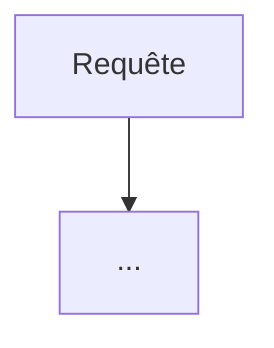

# Architecture — à remplir

Modèle à compléter par l'équipe, en suivant les principes de [reference/guide-architecture-agentique.md](reference/guide-architecture-agentique.md). Un schéma peut être ajouté à côté (`docs/architecture.png` ou un bloc Mermaid ci-dessous). Chaque section se termine par les questions auxquelles elle doit répondre.

Cas d'usage : [use-case-atlas.md](use-case-atlas.md). Critères du jury : [strategie/prompt-jury.md](strategie/prompt-jury.md).

---

## 1. Objectif, décision, action
Quelle décision le système aide-t-il à prendre, et quelle action en découle ?
- Utilisateur principal :
- Entrée (exemple de requête) :
- Sortie (format, contenu) :

## 2. Composants
Pour chaque composant : agent LLM ou code déterministe ? Le jury pénalise « un agent avec plusieurs étiquettes ».

| Composant | Type (LLM / code) | Rôle | Entrées | Sorties | Modèle |
|---|---|---|---|---|---|
| | | | | | |

## 3. Flux de contrôle
Qui décide de l'étape suivante : le code (workflow) ou le modèle (agent) ? Où sont les boucles (critique, révision, retry), les branchements (confiance, conflit) et les escalades vers un humain ? Quelles limites (nombre d'itérations, budget, timeout) ?

## 4. Flux de données
Qu'est-ce qui passe d'un composant à l'autre ? (Le guide : des artefacts et des résumés, pas des transcripts complets.)

## 5. Zetaris
Quelles sources, comment elles sont enregistrées (table REST ou fichier), quelles requêtes SQL l'analyste exécute, que se passe-t-il si Zetaris ne répond pas ?

| Table | Source | Enregistrement | Requêtes typiques |
|---|---|---|---|
| | | | |

## 6. État et mémoire (World Model)
Qu'est-ce qui est stocké (observations, décisions, travail en cours par membre, versions) ? Qui écrit ? Un seul écrivain par ressource ? Comment les conflits sont-ils détectés ? Quel test de conformité prouve que l'engine fonctionne ?

## 7. MCP
Quels outils, avec quels paramètres et quelles sorties ? Quels clients réels pour la démo ? Quelles écritures sont contrôlées avant d'entrer dans l'état ?

| Outil | Paramètres | Sortie | Contrôles |
|---|---|---|---|
| | | | |

## 8. Garde-fous
Habilitations (table des rôles côté backend), contenu externe traité comme des données, budgets, timeouts et fallbacks sur chaque appel sponsor, `SAMPLE_MODE`.

## 9. Traces
Format JSONL : agent, action, résumé d'entrée et de sortie, agent cible, modèle, confiance, nombre de retries, statut. Écrites dans `logs/` et sur la sortie standard.

## 10. Tests et évaluation
Suite de conformité de l'engine, les 14 cas de test du kit, les 6 scénarios, le contrôle anti-triche (changer une date avant une répétition).

## 11. Ce qu'on coupe si le temps manque
Par ordre de priorité. Et ce qu'on ne coupe jamais.
