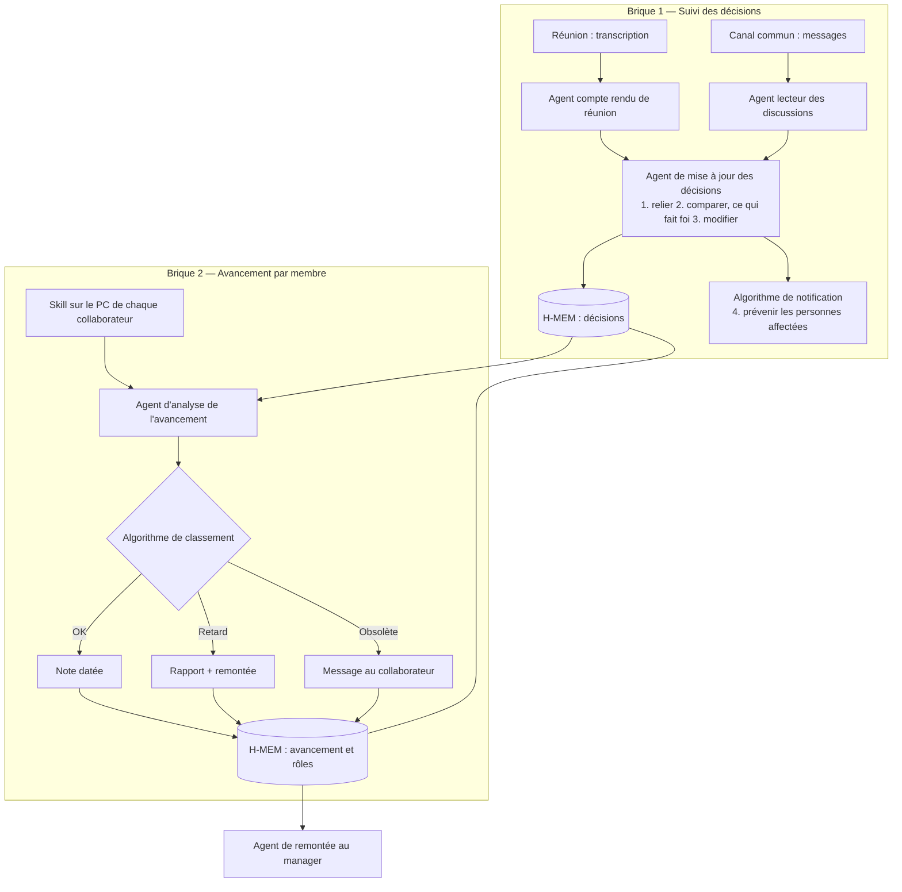

# Architecture — brouillon

État : brouillon en cours, rédigé par l'équipe le 27 octobre 2026. Les sections 1 à 3 et 6 reprennent les décisions de l'équipe ; les autres restent à remplir. Notes manuscrites d'origine : [architecture-notes/](architecture-notes/) (page 1 : suivi des décisions ; page 2 : avancement par membre).

Principes suivis : [reference/guide-architecture-agentique.md](reference/guide-architecture-agentique.md). Cas d'usage : [use-case-atlas.md](use-case-atlas.md). Critères du jury : [strategie/prompt-jury.md](strategie/prompt-jury.md).

---

## 1. Objectif, décision, action
Quelle décision le système aide-t-il à prendre, et quelle action en découle ?
Le système aide à gérer la cohérence dans le travail entre différentes personnes utilisant plusieurs modèle d'IA différentes sur leur PC dans un projet d'entreprises. Il alerte si jamais une personne fait un travail qui a été rendu obsolète par une décision qui a été prise par un autre colaborateur ou une contrainte technique qui est survenu. Il gère aussi généralement l'ensemble des informations relative a un projet ( quelle est la répartition des tâches, quel est le projet en question, quelles sont les deadlines, quelles sont les postes de chacun, quelle est l'avancement de chaque tâches ) et peut en ressortir des informations pertinentes pour la personne en charge du projet ou le manager de l'équipe ( ce système s'adapte donc aussi bien à la gestion d'une équipe par un manager qu'a la réalisation d'un projet cadré, avec chef de projet etc... ). Les informations pertinentes qu'il ressort concerne aussi bien un transfert d'information horizontal ( d'un collaborateur à un autre collaborateur par exemple ), que vertical ( le harness constate une irrégularité ou un problème quelque part dans le projet, remonte l'information jusqu'au manager pour le prévenir ). C'est également lui qui, par le suivis qu'il fait de l'avancé du projet ou du travail de chacun, planifie les réunions lorsqu'il est pertinent et utile d'en faire une pour l'avancer du projet ( l'idée est de limiter le nombre de réunion et de n'avoir que des réunions qui soient utile ). Le système stock également à différentes échelles de mémoire les avancées du projet et garde toutes les données de base qu'il peut récolter ( compte rendu de réunion par exemple, historique des informations d'un projet une fois le projet terminé etc... avec donc des mémoires à plusieurs échelles : mémoire sur le projet en cours, la journée de travail etc... et mémoire de l'ensemble des projets qui ont été fait )
- Utilisateur principal : le manager 
- Entrée (exemple de requête) : Fais moi un compte rendu de l'avancé du projet "X", de ce que chacun a fait, et de savoir si oui ou non nous allons suivre les deadlines que nous avons fixé. Si ce n'est pas le cas explique moi pourquoi. 
- Sortie (format, contenu) : Rapport détaillé qui répond à la question qui a été formulé par le manager. Peut aussi bien prendre la forme d'un rapport écrit que d'un rapport avec une analyse de donnée ou autre ainsi que des recommandations sur ce qui doit être fait si besoin. 

## 2. Composants
Pour chaque composant : agent LLM ou code déterministe ? Le jury pénalise « un agent avec plusieurs étiquettes ».

L'architecture est découpée en **briques**, une par capacité. Deux briques sont définies à ce stade.

### Brique 1 — Suivi des décisions
Bilan de la brique : 1 capacité, 1 mémoire H-MEM, 3 agents, 1 algorithme.

| Composant | Type (LLM / code) | Rôle | Entrées | Sorties | Modèle |
|---|---|---|---|---|---|
| Agent compte rendu de réunion | LLM | Rédige le compte rendu d'une réunion et en extrait les décisions, avec leur historique | Transcription ou notes de réunion | Compte rendu, décisions extraites | Nemotron via Nightshift (à préciser) |
| Agent lecteur des discussions | LLM | Relit les discussions du canal commun (Slack ou autre) et ne ressort que les décisions (deadlines, etc.), en tenant compte du contexte déjà connu | Messages du canal, décisions déjà en mémoire | Décisions candidates | Nemotron via Nightshift (à préciser) |
| Agent de mise à jour des décisions | LLM | ① relie entre elles les décisions déjà prises (dates, deadlines…) ; ② compare avec ce qui a été décidé et **décide ce qui fait foi et ce qui ne fait pas foi**, au regard des données récoltées ; ③ modifie la mémoire en conséquence | Décisions candidates, mémoire des décisions | Mise à jour des décisions dans H-MEM | Nemotron via Nightshift (à préciser) |
| Algorithme de notification | Code déterministe | ④ prévient les personnes affectées par la modification | Mise à jour des décisions, rôles et tâches de chacun | Messages aux collaborateurs concernés | — |
| Mémoire des décisions | H-MEM | Les décisions prises et leur historique | — | — | — |

**Classification des décisions** (utile aussi à la brique 2) :
- deadline sur un livrable ;
- tâche donnée à X personnes, avec deadline.

### Brique 2 — Avancement par membre
Elle s'appuie sur la brique 1 (les décisions classées) et sur une mémoire du rôle de chacun dans le projet.

| Composant | Type (LLM / code) | Rôle | Entrées | Sorties | Modèle |
|---|---|---|---|---|---|
| Skill de rapport d'avancement | Skill installé sur l'IA de chaque collaborateur, sur son PC | Fait remonter l'avancement du travail du collaborateur | Travail du collaborateur | Rapport d'avancement | IA du collaborateur |
| Agent d'analyse de l'avancement | LLM, **sans outil d'écriture** sur les sources qu'il consulte | Lit les rapports envoyés depuis les PC des collaborateurs et les compare aux tâches assignées et aux objectifs | Rapports, tâches, objectifs, décisions (brique 1) | Statut par collaborateur | Nemotron via Nightshift (à préciser) |
| Algorithme de classement (dans l'agent d'analyse) | Code déterministe | Classe chaque situation en trois cas (voir ci-dessous) | Statut par collaborateur | Note, rapport ou message | — |
| Mémoire de l'avancement et des rôles | H-MEM, connectée à la mémoire de la brique 1 | Rôle de chacun dans le projet ; avancement au niveau individuel | — | — | — |
| Agent de remontée au manager | LLM (à définir) | Remontée automatique de l'information au manager | Mémoires des briques 1 et 2 | Informations pour le manager | À définir |

**Les trois cas de l'algorithme de classement :**
1. **Pas de problème** : une note datée (date, heure) indique que tout est en ordre pour cette personne, qui suit sa deadline.
2. **Retard** : même chose, plus un rapport, et l'information remonte.
3. **Travail obsolète** par rapport à une décision prise : un message est envoyé au collaborateur pour le lui signaler.

Dans les trois cas, l'information sur l'avancement du projet au niveau individuel est enregistrée dans la mémoire, reliée à celle de la brique 1.

## 3. Flux de contrôle
Qui décide de l'étape suivante : le code (workflow) ou le modèle (agent) ? Où sont les boucles (critique, révision, retry), les branchements (confiance, conflit) et les escalades vers un humain ? Quelles limites (nombre d'itérations, budget, timeout) ?

Schéma transcrit du brouillon :

À compléter : boucles de critique ou de révision, branchements selon la confiance, escalades vers un humain, limites.

## 4. Flux de données
Qu'est-ce qui passe d'un composant à l'autre ? (Le guide : des artefacts et des résumés, pas des transcripts complets.)

À remplir.

## 5. Zetaris
Quelles sources, comment elles sont enregistrées (table REST ou fichier), quelles requêtes SQL les agents exécutent, que se passe-t-il si Zetaris ne répond pas ?

À remplir. Sources mentionnées dans le brouillon : transcriptions et comptes rendus de réunion, messages du canal commun, tâches assignées, objectifs, rôles.

| Table | Source | Enregistrement | Requêtes typiques |
|---|---|---|---|
| | | | |

## 6. État et mémoires
Choix du brouillon : **H-MEM** porte les mémoires des briques 1 et 2.
- Mémoire des décisions (brique 1) : décisions et historique.
- Mémoire de l'avancement et des rôles (brique 2), connectée à la première.

Questions notées dans le brouillon :
- Comment contrôler l'ensemble de ces décisions ? Sous quel format ? (« Bref, données H-MEM sur décisions : il faut trouver une réponse. »)

Restent à décider : la mémoire de l'organisation (projets passés), qui écrit dans chaque mémoire (un seul écrivain par ressource), la détection des conflits, le test de conformité H-MEM.

## 6 bis. Réunions et remontées au manager
Quelles règles déclenchent une recommandation de réunion (travaux contradictoires, dépendance en retard, jalon à risque, conflit sans arbitrage) ? Qui rédige la recommandation (participants, raison, preuves, ordre du jour) ? Quels événements déclenchent une remontée au manager, et sous quelle forme ? Que voit le manager dans sa vue, sur un petit et sur un gros projet ?

À remplir. Brouillon : la remontée automatique au manager est faite par un agent dédié.

## 7. MCP
Quels outils, avec quels paramètres et quelles sorties ? Quels clients réels pour la démo ? Quelles écritures sont contrôlées avant d'entrer dans l'état ?

Question notée dans le brouillon : quelle méthode pour contacter les personnes affectées par une mise à jour ? Piste : une requête MCP vers les agents installés sur le PC de chacun.

| Outil | Paramètres | Sortie | Contrôles |
|---|---|---|---|
| | | | |

## 8. Garde-fous
Habilitations (table des rôles côté backend), contenu externe traité comme des données, budgets, timeouts et fallbacks sur chaque appel sponsor, `SAMPLE_MODE`.

Déjà dans le brouillon : l'agent d'analyse de l'avancement n'a aucun outil pour modifier les sources qu'il consulte.

## 9. Traces
Format JSONL : agent, action, résumé d'entrée et de sortie, agent cible, modèle, confiance, nombre de retries, statut. Écrites dans `logs/` et sur la sortie standard.

## 10. Tests et évaluation
Suite de conformité de l'engine, les cas de test du kit, les scénarios du cas d'usage, le contrôle anti-triche (changer une date avant une répétition).

## 11. Ce qu'on coupe si le temps manque
Par ordre de priorité. Et ce qu'on ne coupe jamais.

À remplir.
