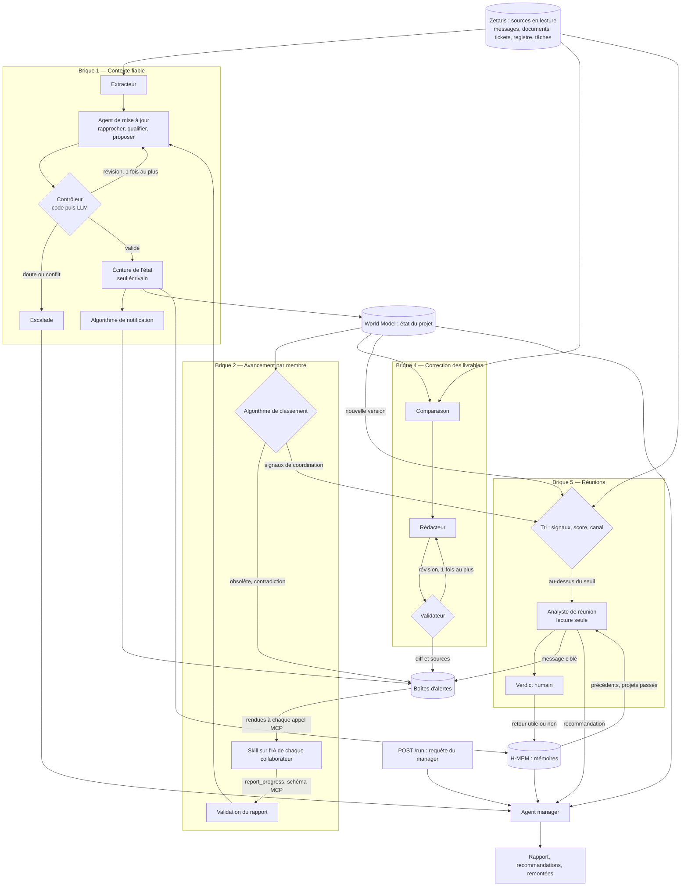

# Architecture — brouillon

**État : brouillon de travail, encore loin de l'architecture finale.** Rédigé par l'équipe le 27 octobre 2026. Il a été complété le même jour avec les propositions A à G de la première revue, puis H à P de la deuxième revue : briques 4 et 5, orchestrateur, placement des mémoires et des engines (voir la fin du document). Notes manuscrites d'origine : [architecture-notes/](architecture-notes/) (page 1 : suivi des décisions ; page 2 : avancement par membre).

Principes suivis : [reference/guide-architecture-agentique.md](reference/guide-architecture-agentique.md). Cas d'usage : [use-case-atlas.md](use-case-atlas.md). Critères du jury : [strategie/prompt-jury.md](strategie/prompt-jury.md).

**Track retenu : 03 — Reasoning Architecture** (proposition G) : l'utilisateur principal est le manager, et le système transforme données et mémoire en décisions et en actions (alertes, corrections, réunions).

---

## 1. Objectif, décision, action
Quelle décision le système aide-t-il à prendre, et quelle action en découle ?
Le système aide à gérer la cohérence dans le travail entre différentes personnes utilisant plusieurs modèle d'IA différentes sur leur PC dans un projet d'entreprises. Il alerte si jamais une personne fait un travail qui a été rendu obsolète par une décision qui a été prise par un autre colaborateur ou une contrainte technique qui est survenu. Il gère aussi généralement l'ensemble des informations relative a un projet ( quelle est la répartition des tâches, quel est le projet en question, quelles sont les deadlines, quelles sont les postes de chacun, quelle est l'avancement de chaque tâches ) et peut en ressortir des informations pertinentes pour la personne en charge du projet ou le manager de l'équipe ( ce système s'adapte donc aussi bien à la gestion d'une équipe par un manager qu'a la réalisation d'un projet cadré, avec chef de projet etc... ). Les informations pertinentes qu'il ressort concerne aussi bien un transfert d'information horizontal ( d'un collaborateur à un autre collaborateur par exemple ), que vertical ( le harness constate une irrégularité ou un problème quelque part dans le projet, remonte l'information jusqu'au manager pour le prévenir ). C'est également lui qui, par le suivis qu'il fait de l'avancé du projet ou du travail de chacun, planifie les réunions lorsqu'il est pertinent et utile d'en faire une pour l'avancer du projet ( l'idée est de limiter le nombre de réunion et de n'avoir que des réunions qui soient utile ). Le système stock également à différentes échelles de mémoire les avancées du projet et garde toutes les données de base qu'il peut récolter ( compte rendu de réunion par exemple, historique des informations d'un projet une fois le projet terminé etc... avec donc des mémoires à plusieurs échelles : mémoire sur le projet en cours, la journée de travail etc... et mémoire de l'ensemble des projets qui ont été fait )
- Utilisateur principal : le manager 
- Entrée (exemple de requête) : Fais moi un compte rendu de l'avancé du projet "X", de ce que chacun a fait, et de savoir si oui ou non nous allons suivre les deadlines que nous avons fixé. Si ce n'est pas le cas explique moi pourquoi. 
- Sortie (format, contenu) : Rapport détaillé qui répond à la question qui a été formulé par le manager. Peut aussi bien prendre la forme d'un rapport écrit que d'un rapport avec une analyse de donnée ou autre ainsi que des recommandations sur ce qui doit être fait si besoin. 

**Point d'entrée** (proposition F) : cette requête du manager est l'entrée principale du système, exposée par `POST /run` (entrée et sortie structurées). C'est ce que les juges appelleront.

**Fonctionnement sans N+1** (proposition O) : le système doit aussi marcher sur une équipe horizontale. La « personne habilitée » (arbitrage, escalade, validation d'une réunion) est lue dans la table des rôles, sujet par sujet. Sans manager ni chef de projet, les recommandations et les escalades vont dans les boîtes d'alertes des membres concernés. Pour la démo, le manager reste l'utilisateur principal (D7).

## 2. Composants
Pour chaque composant : agent LLM ou code déterministe ? Le jury pénalise « un agent avec plusieurs étiquettes ».

L'architecture est découpée en **briques**, une par capacité du cas d'usage (numérotées comme les capacités de [use-case-atlas.md](use-case-atlas.md)). La capacité 3, la coordination, n'a pas de brique à elle : elle est portée par les alertes de la brique 1 et par les cas « obsolète » et « contradiction entre membres » de la brique 2.

| Brique | Capacité | Agents LLM | Code déterministe |
|---|---|---|---|
| 1 — Contexte fiable | Suivi des décisions et de l'état du projet | Extracteur, agent de mise à jour, contrôleur (partie LLM) | Règles d'autorité, contrôles du contrôleur, notification |
| 2 — Avancement par membre | Suivi de chacun, coordination | Aucun | Validation du rapport MCP, classement |
| 4 — Correction des livrables | Action sur les livrables | Rédacteur (l'extraction réutilise l'extracteur de la brique 1) | Comparaison, validateur du diff |
| 5 — Recommandation de réunion | Réunions utiles | Analyste de réunion | Signaux, score, choix du canal, calibration |
| Agent manager | Vue manager, rapport | Synthèse manager | Règles de remontée |
| Orchestrateur | Exécution d'un run | Aucun | Enchaînement, déclenchements, limites, traces |

Au total : **six agents LLM**, chacun avec une seule mission. Le reste est en code.

### Brique 1 — Contexte fiable (suivi des décisions)
Bilan de la brique : 1 capacité, l'état du projet (World Model), la mémoire des décisions (H-MEM), 3 agents, 1 algorithme.

**Principe (proposition H) : le LLM qualifie, le code tranche.** L'agent de mise à jour reste le point d'entrée unique de toute information qui peut modifier l'état du projet. Il compare l'entrée avec ce qui a déjà été décidé, fait et prévu, et propose la mise à jour. Mais la question « est-ce que ça fait foi ? » n'est pas laissée à son jugement. Elle se déduit, par des règles en code ([agent/decisions.py](../agent/decisions.py)), du type d'information, de l'habilitation de l'auteur (table des rôles) et des conflits. Sinon, les règles d'autorité vivraient à deux endroits (le prompt et le code), qui finiraient par diverger. Un LLM aurait par exemple tendance à préférer le message le plus récent, ce que la règle 2 du cas d'usage interdit.

| Composant | Type (LLM / code) | Rôle | Entrées | Sorties | Modèle |
|---|---|---|---|---|---|
| Extracteur | LLM | Extrait les informations d'un texte, selon le type de source. Pour une réunion, il rédige aussi le compte rendu ; pour le canal commun (Slack ou autre), il ne garde que les décisions (deadlines, etc.), en tenant compte du contexte déjà connu ; pour un livrable (brique 4), il relève ses affirmations. Fusion des deux agents du brouillon manuscrit (proposition A) | Texte de la source (lu dans Zetaris), type de source, état du projet | Compte rendu (réunion), informations candidates au format ci-dessous | Nemotron via Nightshift (à préciser) |
| Agent de mise à jour | LLM | Point d'entrée unique de ce qui peut changer l'état : sorties de l'extracteur, rapports d'avancement remontés par MCP (brique 2), tickets. ① rattache chaque information au bon sujet et au bon attribut, et à la décision qu'elle remplacerait (rapprochement) ; ② la qualifie selon les **types d'information** du cas d'usage (proposition, décision, constat, déclaration de travail, avancement…) ; ③ propose la mise à jour de l'état, avec ses preuves | Informations candidates, état du projet (World Model), historique des décisions (H-MEM) | Proposition de mise à jour structurée, avec ses preuves | Nemotron via Nightshift (à préciser) |
| Contrôleur (proposition B) | Règles déterministes, puis LLM | **D'abord en code** : schéma, habilitation de l'auteur (table des rôles, jamais le texte d'un message), conflit avec une décision en vigueur, appartenance au projet (S4), doublon par référence de source (S5). **Puis le LLM** : les preuves citées soutiennent-elles la proposition ? Accepte, demande **une révision au plus** à l'agent de mise à jour, ou **escalade vers la personne habilitée** | Proposition, état du projet, rôles | Mise à jour validée, demande de révision, ou escalade | Nemotron via Nightshift (à préciser) |
| Écriture de l'état | Code | **Seul écrivain** de l'état du projet (principe 6 du guide) : applique la mise à jour validée dans World Model et l'enregistre dans H-MEM | Mise à jour validée | Nouvelle version de l'état | — |
| Algorithme de notification | Code déterministe | ④ détermine les personnes affectées par la modification et dépose une alerte dans leur **boîte d'alertes** (proposition D) | Mise à jour validée, rôles et tâches de chacun | Alertes par collaborateur | — |

**Classification des décisions** (utile aussi à la brique 2) :
- deadline sur un livrable ;
- tâche donnée à X personnes, avec deadline.

### Brique 2 — Avancement par membre
Elle s'appuie sur l'état du projet tenu par la brique 1 (décisions en vigueur, tâches, rôles).

**Principe (proposition I) : le rapport arrive déjà structuré, donc la brique 2 n'a pas d'agent LLM.** Le contrat, c'est le **schéma de l'outil MCP** `report_progress`. Tout client MCP le reçoit (Claude, Cursor…), et le serveur rejette un rapport invalide avec un message qui dit quoi corriger : l'IA du collaborateur se corrige seule. Le **skill** dit seulement à l'IA quand et comment faire son rapport (en fin de session de travail, en déclarant les valeurs sur lesquelles le travail repose). C'est donc l'IA du collaborateur qui fait la structuration, et la comparaison avec ce qui aurait dû être fait est un algorithme ([agent/progress.py](../agent/progress.py)).

**Le rapport est aussi une source pour la brique 1** (proposition J). L'avancement et le travail déclaré modifient l'état du projet : ils passent par l'agent de mise à jour et le contrôleur, comme toute autre source, pour qu'il n'y ait qu'un seul écrivain. Les champs structurés (avancement d'une tâche par son propre responsable) passent les contrôles en code sans appel LLM ; seul le commentaire libre passe par l'agent de mise à jour.

| Composant | Type (LLM / code) | Rôle | Entrées | Sorties | Modèle |
|---|---|---|---|---|---|
| Skill de rapport d'avancement | Skill installé sur l'IA de chaque collaborateur, sur son PC | Dit à l'IA quand faire son rapport et quoi déclarer ; à chaque rapport, affiche les alertes qui l'attendent (proposition D) | Travail du collaborateur | Appel à `report_progress` ; affichage des alertes | IA du collaborateur |
| Outil MCP `report_progress` | Code | Valide le rapport contre le schéma, le transmet à la brique 1, rend les alertes en attente | Rapport structuré (section 7) | Accusé de réception, ou erreur explicite ; alertes | — |
| Algorithme de classement | Code déterministe | Classe la situation de chaque tâche (voir ci-dessous) à partir de l'état du projet | Tâches, derniers rapports, décisions en vigueur, tickets | Constats par membre ; **signaux de coordination** pour la brique 5 | — |

**Les cas de l'algorithme de classement :**
1. **Pas de problème** : une note datée (date, heure) indique que tout est en ordre pour cette personne, qui suit sa deadline.
2. **Retard** : même chose, plus un rapport, et l'information remonte.
3. **Travail obsolète** par rapport à une décision prise : une alerte est déposée dans la boîte du collaborateur pour le lui signaler.
4. **Signal de coordination** (propositions C, puis K) : une même décision rend obsolète le travail de deux personnes ou plus, ou une tâche en retard bloque celle d'un autre membre. Ce cas ne rédige plus de réunion lui-même : il émet un **signal** que la brique 5 note. Une seule brique recommande des réunions (un seul écrivain).
5. **Contradiction entre membres** (proposition L, scénario S6) : deux membres déclarent des valeurs incompatibles sur un même sujet (Hugo retire le SSO, Sarah l'annonce). S'il existe une décision en vigueur, celui qui s'en écarte est en cas 3. Sinon, c'est un conflit à arbitrer : les deux sont prévenus et l'escalade part vers la personne habilitée. **À coder** : aujourd'hui, `progress.py` compare chaque membre à une décision, jamais deux membres entre eux.

**Blocages** (proposition L, règle 5 du cas d'usage : une date validée ne veut pas dire que le lancement est prêt). Un ticket ouvert et bloquant, comme la recette CSV, est relié à la tâche ou au jalon qu'il bloque. Il compte comme un constat dans l'état du projet, et le classement le prend en compte. **À modéliser.**

### Brique 4 — Correction des livrables
Elle traite un livrable comme un rapport d'avancement écrit en texte libre : le même contrôle « obsolète », appliqué à un document (proposition M). C'est la scène 1:10–1:35 de la démo et la demande de Léa.

| Composant | Type (LLM / code) | Rôle | Entrées | Sorties | Modèle |
|---|---|---|---|---|---|
| Extraction des affirmations | LLM (l'extracteur de la brique 1, type de source « livrable ») | Relève les affirmations du livrable au même format que les rapports : sujet, attribut, valeur (par exemple `atlas-launch / launch_date = 3 novembre`, `état = prêt`) | Livrable lu dans Zetaris | Affirmations, avec leur passage dans le texte | Nemotron via Nightshift (à préciser) |
| Comparaison | Code déterministe | Compare chaque affirmation aux décisions en vigueur et aux constats (blocages ouverts) | Affirmations, état du projet | Passages périmés, chacun avec la décision ou le constat qui le contredit | — |
| Rédacteur | LLM | Réécrit **uniquement** les passages périmés | Livrable, passages périmés et leurs sources | Version corrigée | Nemotron via Nightshift (à préciser) |
| Validateur | Code déterministe | Vérifie que chaque changement cite une décision ou un constat, que rien n'est modifié hors des passages signalés et qu'aucune affirmation nouvelle n'apparaît. Demande **une révision au plus** au rédacteur, puis escalade | Livrable, version corrigée, passages signalés | Diff validé avec ses sources, ou escalade | — |

Le diff est déposé chez l'auteur du livrable et visible dans la vue manager. La source n'est jamais modifiée (Zetaris est en lecture, D4) : le système prépare, l'humain applique.

### Brique 5 — Recommandation de réunion
Notes manuscrites et tableau des déclencheurs de l'équipe (27/10), précisés par les propositions N et P. Trois étapes : un tri déterministe, un agent qui juge, et l'évaluation par l'humain.

**Étape 1 — Tri déterministe (code).** Les signaux viennent des briques 1 et 2 et des sources Zetaris ; la brique 5 ne redétecte pas les incohérences, déjà notifiées par les autres briques (conclusion des notes manuscrites). Les signaux sont regroupés en **réunions candidates** : un sujet et les personnes concernées. Le score se calcule par réunion candidate, pas pour le projet entier, sinon un simple mi-parcours déclencherait une réunion avec tout le monde.

| Déclencheur | Condition | Référence | Données | Démo |
|---|---|---|---|---|
| Temporel | Lancement de projet ou de phase ; mi-parcours de chaque phase ; jalon à J-x ; fin de livrable | Gersick | Échéances des tâches et jalons | Oui |
| Interdépendance | Dépendance réciproque entre 2 personnes ou plus, avec une modification récente d'un côté | Thompson, Van de Ven et al. | Dépendances des tâches, décisions récentes (cas 4 de la brique 2) | Oui |
| Blocage | Tâche bloquée par celle d'un autre depuis plus de N jours | Coordination | Dépendances et retards (cas 4 de la brique 2) | Oui |
| Dérive | Glissement du chemin critique au-delà d'un seuil ; changement de périmètre | Gestion de projet | Avancement attendu et réel ; décisions sur le périmètre | Version simple |
| Décision en attente | Décision impliquant plusieurs parties prenantes, non tranchée depuis N jours | Vroom & Yetton | Conflits ouverts (`conflicts()`) et leur date | Oui |
| Changement d'équipe | Arrivée d'un membre, changement de responsable | Socialisation | Historique de la table des rôles | Feuille de route |

Les **coûts** sont soustraits du score, comme dans la littérature sur la charge de réunions (Rogelberg, Perlow) : la charge de réunions de chaque participant cette semaine, l'atteinte aux plages de concentration et le nombre de participants requis. Les deux premiers demandent un agenda : soit une petite table d'agenda synthétique dans Zetaris, soit seulement le nombre de participants pour la démo.

**Choix du canal (proposition N).** L'équivocité (Daft & Lengel, synchronicité des médias) n'est pas un terme du score. Elle choisit le canal : les déclencheurs disent qu'il y a un problème de coordination, l'équivocité dit s'il faut un échange synchrone ou si un message suffit. Indicateur : un fil asynchrone qui dépasse N allers-retours sans décision enregistrée. C'est la règle du cas d'usage : une réunion seulement si l'échange synchrone est plus efficace qu'un message, sinon le système prévient directement les personnes.

**Déclenchement.** Le tri tourne à chaque changement de l'état du projet (une nouvelle version dans World Model) et dans chaque run. Il est en code, donc peu coûteux. L'agent de l'étape 2 n'est appelé que pour une réunion candidate au-dessus du seuil, nouvelle ou dont les signaux ont changé.

**Étape 2 — Analyste de réunion (LLM, lecture seule).** Il est appelé après le tri, sur une réunion candidate. Il n'a que des outils de lecture, avec un nombre d'appels limité.
- **Besoin évident** : il rédige la recommandation (participants, durée, raison, preuves, ordre du jour) et la soumet à la personne habilitée.
- **Doute** : il creuse les données du projet (qui a fait ou fini quoi, ce qu'une réunion apporterait) et consulte les **précédents** dans H-MEM : verdicts sur des réunions semblables, enseignements des projets passés (le projet Orion, scénario S9).
- Sortie, une parmi trois : `réunion`, `message ciblé` (déposé dans les boîtes d'alertes) ou `rien`, toujours avec ses raisons.

**Étape 3 — Évaluation et calibration (proposition P).** La personne habilitée accepte ou refuse, et dit si la réunion a été utile. Ce verdict est enregistré dans H-MEM (retour `helpful` ou `not_helpful`, qui modifie la confiance des précédents) et sert à l'étape 2 des fois suivantes : c'est la mémoire des décisions passées qui change le résultat, le signal fort du track 03. Les poids du tri ne sont **jamais modifiés par un agent** : un ajustement est calculé en code à partir de l'historique des verdicts, présenté à l'humain sous forme de diff, appliqué seulement après validation, et versionné pour pouvoir revenir en arrière. Pour la démo : un verdict enregistré et un ajustement montré ; le reste en feuille de route.

### Agent manager (proposition F, recentré par la proposition K)
| Composant | Type (LLM / code) | Rôle | Entrées | Sorties | Modèle |
|---|---|---|---|---|---|
| Agent manager | LLM | Une seule mission : répondre à la requête du manager (section 1) : avancement du projet, travail de chacun, tenue des deadlines et pourquoi. Les recommandations de réunion viennent de la brique 5 | État du projet, mémoires, alertes, escalades, recommandations, remontées | Rapport au manager | Nemotron via Nightshift (à préciser) |
| Règles de remontée | Code déterministe | Décident ce qui remonte au manager sans qu'il le demande (section 6 bis) | Changements d'état | Remontées dans la vue manager | — |

### Orchestrateur (proposition K)
Code déterministe. Il enchaîne un run : lecture des sources dans Zetaris, brique 1, puis briques 2 et 4, puis brique 5, règles de remontée, synthèse manager. Il porte aussi les déclenchements (à chaque changement d'état, à chaque `POST /run`), les limites (itérations, budget, timeouts), les replis et `SAMPLE_MODE`, et écrit les traces. Sans lui, un juge ne peut pas lancer le système de bout en bout.

## 3. Flux de contrôle
Qui décide de l'étape suivante : le code (workflow) ou le modèle (agent) ? Où sont les boucles (critique, révision, retry), les branchements (confiance, conflit) et les escalades vers un humain ? Quelles limites (nombre d'itérations, budget, timeout) ?

Boucles de critique : contrôleur et agent de mise à jour (brique 1), validateur et rédacteur (brique 4) ; une révision au plus, puis escalade. Branchements : sortie du contrôleur, seuil du tri, choix du canal, issue de l'analyste. Restent à chiffrer : seuils, nombre d'appels d'outils de l'analyste, budgets et timeouts.

## 4. Flux de données
Qu'est-ce qui passe d'un composant à l'autre ? (Le guide : des artefacts et des résumés, pas des transcripts complets.)

- Entre agents : des enregistrements structurés (informations candidates, propositions de mise à jour, affirmations, réunions candidates), jamais le texte complet des sources, sauf pour l'extracteur et le rédacteur, qui travaillent sur le texte.
- Chaque enregistrement porte sa source (table Zetaris et identifiant, rapport MCP, réunion), pour que chaque sortie cite ses preuves.

À compléter.

## 5. Zetaris
Quelles sources, comment elles sont enregistrées (table REST ou fichier), quelles requêtes SQL les agents exécutent, que se passe-t-il si Zetaris ne répond pas ?

L'équipe définira les sources plus tard (décision du 27/10). Proposition de départ, pour que Zetaris porte la charge et que le jury le voie :

| Source dans Zetaris | Lue par |
|---|---|
| Messages du canal commun, transcriptions de réunion | Extracteur (brique 1) ; indicateur d'équivocité (brique 5) |
| Documents et livrables (briefs) | Extracteur, type « livrable » (brique 4) |
| Tickets | Agent de mise à jour (constats, blocages) ; classement (brique 2) |
| Registre des décisions | Agent de mise à jour (brique 1) |
| Tâches, objectifs, dépendances | Classement (brique 2) ; tri de la brique 5 |
| Agenda (option) | Coûts de la brique 5 |
| Archives des projets passés | Import dans la mémoire de l'organisation (H-MEM, long terme) |

Les déclencheurs de la brique 5 qui portent sur les sources (échéances, dépendances, fils de messages) peuvent être des requêtes SQL sur Zetaris.

## 6. État et mémoires
Proposition Q de la deuxième revue : **trois couches, chacune avec un rôle distinct.** Elle remplace D9 (voir [DECISIONS.md](DECISIONS.md), D12).

| Couche | Ce qu'elle contient | Pourquoi elle |
|---|---|---|
| **Zetaris** | Les sources brutes de l'entreprise, en lecture seule | Couche de données imposée ; aucune écriture vérifiée (D4) |
| **World Model** | **L'état courant du projet** : membres et rôles, tâches et dépendances, jalons, livrables, décisions en vigueur, blocages, avancement déclaré | Journal d'événements en ajout seul, d'où des versions de l'état (S2) ; ingestion idempotente et identifiants stables, d'où pas de doublon (S5) ; relations datées (`validFrom`, `validTo`) ; vues graphe (dépendances, utiles à la brique 5) et chronologie (échéances) ; file d'écriture à un seul écrivain ; résolution des conflits réglable sur « manuel », ce qui respecte la règle 3 |
| **H-MEM, court terme** | La journée et la session : rapports bruts, alertes rendues | La mémoire « journée de travail » du brouillon |
| **H-MEM, travail** | Le projet en cours : historique des décisions avec leur provenance, comptes rendus de réunion, verdicts sur les réunions | Provenance et confiance obligatoires ; journal de confiance qui trace chaque changement (« pourquoi le système dit-il 10 novembre ? ») ; retours `helpful` ou `wrong` qui modifient la confiance |
| **H-MEM, long terme** | L'organisation : enseignements des projets passés (Orion), précédents de réunions | Le « dreaming » propose des enseignements en fin de projet, un humain les approuve, et chacun garde le lien vers ses sources : c'est la capitalisation de la capacité 9 |

Les deux engines se complètent : World Model répond à « quel est l'état maintenant ? », H-MEM à « que s'est-il passé, que sait l'organisation, et pourquoi ? ». Le passage de World Model vers H-MEM (« world facts sync into memory ») est l'un des flux prévus par Meterless entre ses engines.

**Points d'attention :**
- La détection de conflits de H-MEM tourne une fois par jour et peut trancher seule au-dessus d'une confiance de 0,70. Pour les décisions, cette résolution automatique est désactivée : les conflits sont détectés par le contrôleur à chaque mise à jour et arbitrés par un humain (règle 3).
- Si le temps manque, World Model peut être remplacé par un état en JSON côté Python, derrière la même interface ; H-MEM, dont la conformité est déjà au vert, reste l'engine obligatoire.

**Engines non retenus pour le MVP :**
- **Scout Intent** : utile pour aiguiller la requête du manager et filtrer les injections dans les messages. Mais il n'existe qu'en spécification, sans implémentation de référence ni suite de conformité : feuille de route.
- **Markovian** : fait pour les longues chaînes de raisonnement ; le corpus Atlas est petit, il n'apporterait rien.

Format d'un enregistrement de décision, **un enregistrement par décision** :

| Champ | Contenu |
|---|---|
| `sujet` | Ce sur quoi porte la décision (par exemple « lancement Atlas ») |
| `attribut` | Date, périmètre, responsable, deadline d'un livrable, tâche assignée |
| `valeur` | La valeur décidée (par exemple « 10 novembre ») |
| `statut` | Proposition, approuvée, remplacée |
| `auteur` | Qui l'a prise (vérifié contre la table des rôles) |
| `source` | D'où elle vient (réunion, message, registre), avec sa référence |
| `date` | Quand elle a été prise |
| `confiance` | Niveau de confiance de l'extraction (H-MEM l'exige) |
| `remplace` | La décision qu'elle remplace, le cas échéant |

Avec ce format, le contrôleur et les algorithmes comparent des champs, pas du texte libre.

Restent à décider : l'emplacement de la table des rôles (proposition : une entité de World Model, alimentée depuis Zetaris), le mode d'intégration des engines (D11).

## 6 bis. Réunions et remontées au manager
- **Réunions** : portées par la brique 5 (tri, analyste, verdict). Le système recommande, la personne habilitée décide : aucune invitation n'est envoyée automatiquement.
- **Remontées** : des règles en code sur les changements d'état. Départ proposé : un retard (cas 2), un conflit ouvert ou une escalade du contrôleur, une décision validée qui change une date ou le périmètre, un livrable corrigé, une réunion recommandée.
- À définir : la forme des remontées et la vue manager (petit et gros projet).

## 7. MCP
Quels outils, avec quels paramètres et quelles sorties ? Quels clients réels pour la démo ? Quelles écritures sont contrôlées avant d'entrer dans l'état ?

**Principe (proposition D)** : un serveur MCP répond quand le client l'appelle ; il ne peut pas contacter de lui-même l'IA d'un collaborateur. Les alertes sont donc **récupérées, pas poussées** : chaque membre a une boîte d'alertes, rendue quand son IA appelle le serveur (par exemple à chaque rapport du skill), et visible dans la vue manager.

| Outil | Paramètres | Sortie | Contrôles |
|---|---|---|---|
| `report_progress` (appelé par le skill) | Membre, tâche, avancement (0 à 1), valeurs sur lesquelles le travail repose (liste de sujet, attribut, valeur), blocages, commentaire libre | Accusé de réception + alertes en attente, ou erreur qui dit quoi corriger | Schéma validé par le serveur ; le membre est connu ; l'écriture passe par la brique 1 |
| `get_alerts` | Membre | Alertes en attente | Lecture seule |
| `get_project_context` | Membre ou projet | Décisions en vigueur, tâches, alertes, version de l'état | Lecture seule |

À compléter : autres outils, clients réels de la démo.

## 8. Garde-fous
Habilitations (table des rôles côté backend), contenu externe traité comme des données, budgets, timeouts et fallbacks sur chaque appel sponsor, `SAMPLE_MODE`.

Déjà prévu :
- aucun agent n'écrit directement dans l'état : un seul écrivain, après le contrôleur ;
- l'autorité d'une information est décidée par des règles en code, jamais par un prompt ;
- l'analyste de réunion n'a que des outils de lecture ;
- les poids du tri de la brique 5 ne changent qu'après validation humaine ;
- le contrôleur vérifie les habilitations contre la table des rôles avant toute écriture.

## 9. Traces
Format JSONL : agent, action, résumé d'entrée et de sortie, agent cible, modèle, confiance, nombre de retries, statut. Écrites dans `logs/` et sur la sortie standard.

## 10. Tests et évaluation
Suites de conformité des engines, les cas de test du kit, les scénarios du cas d'usage, le contrôle anti-triche (changer une date avant une répétition).

## 11. Ce qu'on coupe si le temps manque
Par ordre de priorité. Et ce qu'on ne coupe jamais.

Proposition, de ce qu'on coupe en premier à ce qu'on garde toujours :
1. Calibration des poids de la brique 5 (on garde l'enregistrement du verdict).
2. Coûts liés à l'agenda dans la brique 5 (on garde le nombre de participants).
3. Mémoire de l'organisation au-delà d'un enseignement rappelé (Orion).
4. World Model, remplacé par un état en JSON derrière la même interface.

On ne coupe jamais : la brique 1 avec le contrôleur, la brique 2, la brique 4 sur le brief, H-MEM avec son test, Zetaris interrogé en SQL, Nightshift, les traces et le rapport au manager.

---

## Historique des propositions intégrées
### Première revue (27/10)
| # | Proposition | Intégrée dans |
|---|---|---|
| A | Fusion des agents compte rendu et lecteur des discussions en un extracteur de décisions | Brique 1 |
| B | Contrôleur avec une révision au plus, puis escalade | Brique 1, flux de contrôle |
| C | 4e cas « réunion nécessaire » dans l'algorithme de classement | Brique 2, puis remplacé par K |
| D | Alertes récupérées via MCP (boîtes d'alertes), pas poussées | Briques 1 et 2, section 7 |
| E | Sources servies par Zetaris | Proposition de départ en section 5 |
| F | Agent manager comme point d'entrée `POST /run` | Sections 1 et 2 |
| G | Track 03 — Reasoning Architecture | En-tête, `DECISIONS.md` |

### Deuxième revue (27/10)
| # | Proposition | Intégrée dans |
|---|---|---|
| H | L'agent de mise à jour qualifie et propose ; l'autorité est décidée par des règles en code | Brique 1 |
| I | Rapports d'avancement structurés par le schéma de l'outil MCP ; pas d'agent LLM dans la brique 2 | Brique 2, section 7 |
| J | Les rapports d'avancement sont une source de la brique 1 (un seul écrivain de l'état) | Briques 1 et 2 |
| K | Le cas 4 émet des signaux pour la brique 5 ; l'agent manager ne fait que la synthèse ; orchestrateur en code | Briques 2 et 5, agent manager, orchestrateur |
| L | Contradiction entre membres (S6) et blocages par tickets (règle 5) | Brique 2 |
| M | Brique 4 : extraction, comparaison en code, rédacteur, validateur | Brique 4 |
| N | Brique 5 : réunions candidates, équivocité pour choisir le canal, déclenchement à chaque changement d'état | Brique 5 |
| O | Fonctionnement sans N+1 : personne habilitée lue dans la table des rôles | Section 1 |
| P | Calibration de la brique 5 par les verdicts humains dans H-MEM ; poids modifiés seulement après validation humaine | Brique 5, garde-fous |
| Q | Trois couches : Zetaris (sources), World Model (état courant), H-MEM (mémoires à trois échelles) | Section 6, `DECISIONS.md` (D12) |
